# AlumniConnect — Phase 1
## Requirement Analysis and System Planning

**Master reference for the 15-phase build.**
Every later design, database, API, frontend and integration decision in this
project should be traceable to a requirement in this document.

| Field | Value |
|---|---|
| Project | AlumniConnect |
| Title | Centralized Alumni Data Management & Student Collaboration Platform |
| Tagline | Real Problems. Student Solutions. Alumni Recognition. Career Opportunities. |
| Document | Phase 1 — Requirement Analysis and System Planning |
| Version | 1.0 |
| Date | 31 October 2026 |
| Status | Approved as the build baseline |
| Primary source | `AlumniConnect_Complete_Project_Plan.pdf` (8 pages, SIH planning document) |
| Secondary source | Updated landing-page design brief (product identity, feature presentation, visual direction) |
| Existing implementation | Landing page (Phase 1 code) + API scaffold with 6 Prisma models (Phase 2 code) — see Appendix C |

### How to read this document

Every non-obvious statement is tagged so the team can tell what came from the
source material and what is an engineering recommendation.

| Tag | Meaning |
|---|---|
| **[SRC]** | Derived from `AlumniConnect_Complete_Project_Plan.pdf`. Must not be contradicted. |
| **[DEC]** | A decision already confirmed by the project owner. Not open for change. |
| **[PROP]** | Proposed by this document to make the source buildable. Reviewable, but default to it. |
| **[ASSUME]** | An assumption that must be validated before the phase that depends on it. |
| **[FUTURE]** | Explicitly out of MVP scope. |

Content rules applied throughout:

- No invented partnerships, statistics, testimonials, or employment outcomes.
- Alumni appreciation ≠ university credential, accreditation, or academic credit. **[SRC]**
- Student consent governs portfolio visibility and company access. **[SRC]**
- Paid and unpaid tasks are always distinguishable. **[SRC]**
- AI Alumni Twin and blockchain are future, optional, and must not be presented as shipped. **[SRC]**
- All numbers used in demos are labelled demonstration data.

---

## 1. Project Overview

### 1.1 What AlumniConnect is

AlumniConnect is a centralized digital ecosystem in which university alumni
share professional experience and real industry problems, current students solve
those problems, and the resulting work becomes credible evidence of skill. **[SRC]**

Four groups interact through one shared data model:

1. **Alumni** publish challenges and tasks, evaluate work, recognise contributions, and mentor. **[SRC]**
2. **Students** participate, submit solutions, build portfolios, and request mentorship. **[SRC]**
3. **University administrators** maintain alumni records and monitor engagement. **[SRC]**
4. **Companies / recruiters** discover student-approved portfolios and invite students for further assessment. **[SRC]**

A browser-based **3D Metaverse Alumni Hub** provides an interactive entry point
into the same platform: Career Hall, Mentorship Room, Innovation Lab, Alumni
Challenge Arena, and Wall of Recognition. **[SRC]**

### 1.2 One-line pitch

Alumni bring real problems, students deliver solutions, alumni recognise talent,
and companies discover skills. **[SRC]**

### 1.3 What the platform is *not*

Stating these boundaries prevents overclaiming in demos, reports and the UI:

- It is **not** an official university certificate authority. **[SRC]**
- It does **not** guarantee employment, internships or interviews. **[SRC]**
- It does **not** hold or transfer money in the MVP; it records agreed terms. **[SRC]**
- It is **not** a VR product; no headset is required. **[SRC]**
- It is **not** a social network; the unit of value is completed project work. **[PROP]**
- It does **not** put personal data or private files on a blockchain. **[SRC]**

### 1.4 Core value loop **[SRC]**

```
Alumni experience → real challenge → student solution → alumni evaluation
        → recognition → student portfolio → company discovery → new opportunity
        ↑                                                              │
        └──────────────── alumni engagement / mentorship ──────────────┘
```

---

## 2. Objectives

### 2.1 Product objectives

| ID | Objective | Source |
|---|---|---|
| OBJ-1 | Centralise alumni information that is currently fragmented across departments, spreadsheets and personal contacts. | [SRC] |
| OBJ-2 | Give students access to real industry problems and structured feedback. | [SRC] |
| OBJ-3 | Give alumni a structured workflow to delegate work, evaluate it, and recognise it. | [SRC] |
| OBJ-4 | Turn completed work and recognition into a permissioned student portfolio. | [SRC] |
| OBJ-5 | Let companies discover demonstrated skills with explicit student consent. | [SRC] |
| OBJ-6 | Give universities a single view of alumni engagement and collaboration. | [SRC] |
| OBJ-7 | Make engagement interactive through a browser-based 3D campus that reuses the same APIs. | [SRC] |

### 2.2 User objectives

| Role | What success looks like for them |
|---|---|
| Alumni | Post a real problem in minutes, receive usable student work, recognise the best contribution, and stay connected to the university. |
| Student | Work on a real problem, get named feedback, earn a verifiable appreciation record, and show evidence to companies. |
| Administrator | Know how many alumni are active, what challenges exist, and which students participated — with exportable reports. |
| Company | Search consented portfolios by demonstrated skill and invite a student for further assessment. |

### 2.3 Technical objectives

| ID | Objective | Verification |
|---|---|---|
| TOBJ-1 | One integrated platform: shared auth, shared database, shared APIs across 2D pages and the 3D hub. | Same session cookie/token works in both; no duplicated demo data store. |
| TOBJ-2 | Role-based access enforced on the server, not only hidden in the UI. | Negative tests: student calling alumni endpoints receives 403. |
| TOBJ-3 | Every collaboration step produces durable, queryable data. | Challenge → submission → evaluation → certificate chain is reconstructable from the DB. |
| TOBJ-4 | PostgreSQL-ready schema; SQLite used only for local development convenience. | A single provider switch plus enum conversion moves the schema to PostgreSQL. |
| TOBJ-5 | Core actions remain usable without 3D and on a mid-range phone. | 2D fallback covers every 3D entry point; 360 px layout has no overflow. |

### 2.4 Success measures (targets, not results)

These are **goals**. No value below has been measured or achieved; they exist so
later phases have something testable.

| Measure | Target | How it would be verified |
|---|---|---|
| Complete demo journey | Alumni posts → student submits → alumni evaluates → certificate verifies → portfolio updates | End-to-end scripted test on seeded data |
| Challenge → certificate cycle time | Under 5 minutes in a live demo | Timed rehearsal |
| Certificate verification | 100 % of issued certificates resolve to a valid record | Automated check over all issued records |
| Consent enforcement | 0 consented-only records exposed to companies without permission | Permission test matrix |
| Accessibility | WCAG 2.1 AA for text contrast, focus, labels on core flows | Automated + manual audit |
| Responsive support | No horizontal overflow at 360–1440 px | Browser audit at six widths |

---

## 3. Scope

### 3.1 In scope for the MVP **[DEC]**

- Registration, login, email verification, four roles, role-based access control.
- Alumni and student profiles; alumni directory with search and filters.
- Challenge creation, publishing, browsing, filtering, participation.
- Submission of files, repository links, demo links.
- Evaluation with a published rubric, scores, feedback, challenge-scoped ranking.
- Appreciation certificate generation, PDF, QR verification page, SHA-256 record hash.
- Student portfolio with per-item visibility control.
- Compact 3D campus: lobby + Challenge Arena + Innovation Lab, clickable into real pages.
- University admin view of alumni, challenges, participation and certificates.
- Audit log for privileged actions.

### 3.2 Out of scope for the MVP **[FUTURE]**

Full company talent marketplace, online payments, advanced mentorship scheduling,
Knowledge Vault search, AI Alumni Twin, blockchain anchoring, multiplayer avatars,
voice chat, full virtual campus, advanced event management, native mobile apps.

### 3.3 Constraints and assumptions

| Type | Statement |
|---|---|
| Constraint | Student hackathon team; limited weeks; must demo reliably offline-ish. **[SRC]** |
| Constraint | No payment processing in MVP. **[SRC]** |
| Constraint | No VR hardware requirement. **[SRC]** |
| Constraint | 3D hub must not be the only path to any feature. **[SRC]** |
| Assumption | One university is modelled first; multi-university is a schema concern, not an MVP feature. **[ASSUME]** |
| Assumption | Email delivery is simulated or console-logged in local development. **[ASSUME]** |
| Assumption | File storage uses a local private disk adapter in dev and object storage in deployment. **[PROP]** |
| Assumption | Demo content is seeded, labelled as demonstration data, and never presented as real outcomes. **[SRC]** |

---

## 4. Problem Statement and Proposed Solution

AlumniConnect is **designed to address** the problems below. It has not yet
solved them, and no claim of measured impact should be made. **[SRC]**

| # | Problem | Root cause | Impact on users | Proposed solution | Module |
|---|---|---|---|---|---|
| P1 | Fragmented alumni information | Records live in spreadsheets, department folders, personal contacts and disconnected tools; no shared ownership or update path | Administrators cannot answer basic questions; alumni data goes stale; students and companies cannot find the right people | Centralized Alumni Data Hub with structured profiles, skills, expertise, visibility rules and search | M1 |
| P2 | Limited access to real-world projects | Coursework is theoretical; industry problems stay inside companies; no low-friction channel to hand a scoped problem to students | Students graduate without practical evidence; alumni cannot tap student energy | Alumni Challenge Hub: scoped problems with skills, deliverables, deadlines and criteria | M2 |
| P3 | Unstructured alumni collaboration | Willing alumni lack a place to post work, select students, review output and close the loop | Informal help does not scale; no record of who did what; recognition is ad hoc | Participation, submission, evaluation, feedback, ranking and recognition workflow | M3, M4, M6 |
| P4 | Limited student skill visibility | Degrees and marks do not show applied ability; project work is scattered across repositories and drives | Students cannot prove skills; recruiters rely on proxies | Skill portfolio built from completed challenges, feedback and appreciation records | M7 |
| P5 | Difficulty discovering student talent | Recruiters have no consented, evidence-based view of student work | Companies miss capable students; students miss opportunities | Consent-based company discovery with skill filters and portfolio access records | M8 |
| P6 | Limited university engagement monitoring | No central record of alumni participation, mentorship or student collaboration | Engagement reporting is manual and incomplete; successful initiatives are invisible | University engagement dashboard with alumni, challenge, participation, mentorship and certificate analytics | M10 |

**Cross-cutting enabler:** the 3D Metaverse Alumni Hub (M11) makes the ecosystem
explorable and demo-able, but it reads from the same modules rather than creating
a parallel product. **[SRC]**

---

## 5. Users, Roles and Permissions

### 5.1 Role definitions

| Role | Definition | Primary goals | Account verification |
|---|---|---|---|
| **ALUMNI** | A graduate of the university who offers experience, problems, evaluation and mentorship. | Publish credible challenges, find capable students, recognise work, mentor. | Email verified; alumni status optionally verified by an administrator. **[SRC]** |
| **STUDENT** | A currently enrolled student seeking practical work and evidence. | Find relevant challenges, submit strong work, build a portfolio, get mentorship. | Email verified; student status optionally verified. **[PROP]** |
| **ADMIN** | University staff operating the platform. | Maintain records, verify identities, monitor engagement, moderate content, export reports. | Created by invitation only; never self-registered. **[PROP]** |
| **COMPANY** | A recruiter or company representative. | Discover consented student evidence and invite students for assessment. | Email verified; company domain/identity reviewed by an administrator. **[PROP]** |

Additional account states (not roles): `UNVERIFIED`, `ACTIVE`, `SUSPENDED`,
`ALUMNI_VERIFIED`, `COMPANY_VERIFIED`. These are flags and statuses on the user,
not separate roles, so a user keeps one identity.

### 5.2 Capability matrix

Legend: **✓** allowed · **◐** allowed with a condition (own record / consent /
challenge scope) · **—** denied.

| Capability | Alumni | Student | Admin | Company |
|---|---|---|---|---|
| Register / log in | ✓ | ✓ | ✓ (invited) | ✓ |
| Edit own profile | ✓ | ✓ | ✓ | ✓ |
| View public alumni directory | ✓ | ✓ | ✓ | ◐ (limited fields) |
| See alumni contact details | ◐ (own choice) | ◐ (alumni visibility setting) | ✓ | — |
| Publish a challenge | ✓ | — | ◐ (moderation) | — |
| Publish a paid task with terms | ✓ | — | ◐ (moderation) | — |
| Browse open challenges | ✓ | ✓ | ✓ | — |
| Apply / participate in a challenge | — | ✓ | — | — |
| Submit work | — | ✓ (own participation) | — | — |
| View another student's private submission | — | — | ◐ (audit-logged) | — |
| Evaluate a submission | ◐ (challenge owner) | — | — | — |
| Rank submissions within a challenge | ◐ (challenge owner) | — | — | — |
| Issue an appreciation certificate | ◐ (challenge owner) | — | ◐ (revoke only) | — |
| Verify a certificate | ✓ | ✓ | ✓ | ✓ (public page) |
| View own portfolio | ✓ | ✓ | — | — |
| Set portfolio item visibility | — | ✓ (own items) | — | — |
| Browse consented portfolios | — | — | ◐ (audit-logged) | ✓ (permission only) |
| Send an interview / internship invitation | — | — | — | ✓ (consented students) |
| Request mentorship | — | ✓ | — | — |
| Accept mentorship request | ✓ | — | — | — |
| View university analytics | — | — | ✓ | — |
| Verify alumni / company identity | — | — | ✓ | — |
| Suspend an account | — | — | ✓ | — |
| Enter the 3D campus | ✓ | ✓ | ✓ | ◐ (read-only areas) |
| Export engagement report | — | — | ✓ | — |

### 5.3 Permission rules that must be enforced server-side **[PROP]**

1. Every protected route resolves the caller from the session/token, never from a
   client-supplied `userId` or `role` field.
2. Ownership checks run before role checks for record-level actions
   ("is this your challenge?", "is this your submission?").
3. Company access always requires an active consent record for that student;
   consent can be revoked and takes effect immediately.
4. Admins can see more, but not silently: every admin read of private data writes
   an audit entry.
5. A revoked or expired certificate remains resolvable but reports `REVOKED`.
6. Suspension blocks new sessions and invalidates existing refresh tokens.

### 5.4 Consent model **[SRC]**

| Consent scope | Default | Who controls | Effect |
|---|---|---|---|
| Portfolio public to logged-in companies | Off | Student | Company search may return the item. |
| Show real name to companies | Off | Student | Companies see a display handle until enabled. |
| Allow direct invitations | Off | Student | Company invite buttons disabled. |
| Publish item in the 3D Wall of Recognition | Off | Student | Item appears only in 2D private view. |
| Alumni profile visible in directory | On | Alumni | Alumni can hide company or contact fields. |

Consent is stored as explicit records with timestamps, not as a boolean hidden on
a profile, so that access can be audited and withdrawn.

---

## 6. Complete Platform Workflow

### 6.1 Primary end-to-end flow

This is the workflow the MVP must prove. Each step names the actor, the record it
creates, and what the next step consumes. **[SRC]**

| # | Actor | Action | Record written | Consumed by next step |
|---|---|---|---|---|
| 1 | Visitor | Registers with email, password and role | `users` (UNVERIFIED) | Verification |
| 2 | System | Verifies email; administrator verifies alumni/company claims | `users.emailVerified`, `alumni_profiles.verifiedAt` | Protected routes |
| 3 | Alumni | Completes professional profile | `alumni_profiles`, `profile_skills` | Challenge attribution, directory, mentorship matching |
| 4 | Alumni | Publishes a challenge with scope, deliverables, deadline, rubric | `challenges`, `challenge_skills`, `evaluation_criteria` | Browsing |
| 5 | Student | Browses and joins the challenge | `challenge_participants` (APPLIED → ACTIVE) | Submission rights |
| 6 | Student | Develops the solution outside the platform | — | Submission |
| 7 | Student | Submits files, repository link, demo link | `submissions`, `submission_assets` | Evaluation queue |
| 8 | Alumni | Reviews submissions for own challenge | — (read) | Scoring |
| 9 | Alumni | Scores each criterion and adds feedback | `evaluations`, `evaluation_scores` | Ranking |
| 10 | Alumni | Selects outstanding work and publishes results | `submissions.isTop`, `challenges.status = EVALUATED` | Certificate eligibility |
| 11 | Alumni | Issues an appreciation certificate | `certificates` (+ PDF, hash, QR URL) | Verification, portfolio |
| 12 | System | Serves a public verification page | read-only | Anyone with the ID/QR |
| 13 | Student | Adds work and certificate to portfolio with visibility choice | `portfolio_items`, `consent_records` | Company discovery |
| 14 | Company | Searches only consented portfolios | `company_access_logs` | Invitation |
| 15 | Company | Sends an interview/internship/assessment invitation | `opportunities` | Student response |
| 16 | Student | Requests mentorship from alumni | `mentorship_requests` | Session |
| 17 | Admin | Reviews engagement analytics and exports a report | `audit_logs`, report file | University reporting |

**Information movement in plain language.** Registration creates the identity
that every later row points to. The alumni profile supplies the author and
credibility context for a challenge. A challenge is the container that owns its
rubric, skills, participants and submissions. A submission is meaningless without
a participation record, and an evaluation is meaningless without a submission.
Certificates point at an evaluation, not at a student in general, so a certificate
can always be traced back to the work that earned it. Portfolio items are
references to completed work plus the student's consent decision. Company access
reads only what consent exposes and writes an access log. Analytics are derived
from these same tables rather than maintained separately.

### 6.2 Sequence diagram

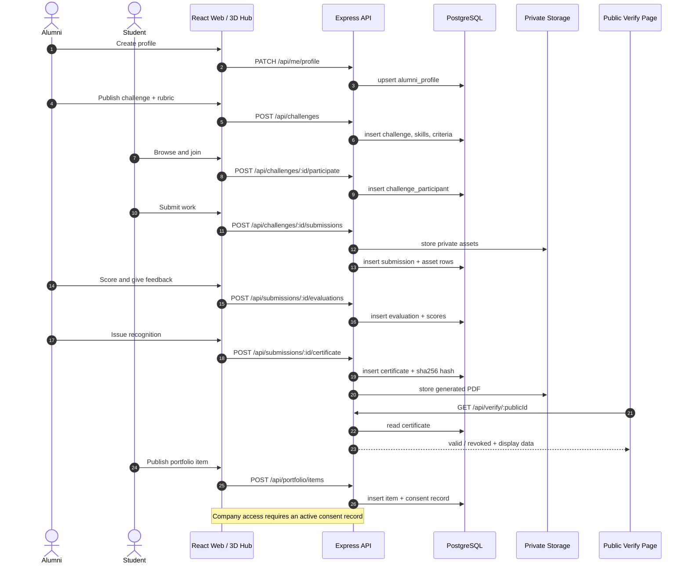

### 6.3 Alternate journeys

**A. Alumni mentorship** **[SRC]**

1. Alumni enables `mentorshipOpen` and lists expertise and availability.
2. Student filters mentors by skill/industry and sends a request with a topic.
3. Alumni accepts, proposes a slot, or declines with a reason.
4. A session record stores topic, time, participants and notes.
5. Session outcomes can be attached to the student's portfolio only with consent.
6. Career talks are listed as events; recordings/resources enter the Knowledge
   Vault only after alumni approval.

**B. Paid and unpaid tasks** **[SRC]**

1. Alumni chooses `isPaid` and, when paid, must supply scope, deliverables,
   deadline, reward terms, revision policy, ownership and acceptance criteria.
2. The UI renders a visible Paid/Unpaid label plus a terms summary before a student
   can apply.
3. Alumni selects a student (or team in a future phase) and both sides confirm.
4. Student submits; alumni accepts or requests agreed revisions.
5. The platform records completion and the agreed terms. **Money is not processed
   in the MVP**; payment happens through an externally agreed method.
6. The record can still lead to an appreciation certificate.

**C. Company talent discovery** **[SRC]**

1. Company registers; an administrator verifies the organisation.
2. Company searches by skill, challenge category or demonstrated project.
3. Results include only portfolio items with active consent; the student's real
   name is hidden unless separately permitted.
4. Opening an item writes an access log entry.
5. Company sends an invitation (interview, internship, assessment).
6. Student accepts or declines; the company sees only the response, not other
   companies' activity.
7. Revoking consent immediately removes the item from future searches.

**D. University administration** **[SRC]**

1. Admin signs in through an invited account.
2. Reviews alumni records, verifies identities, and merges duplicates.
3. Monitors challenges, participation, completion and mentorship activity.
4. Reviews certificate issuance and can revoke a certificate with a reason.
5. Exports a labelled engagement report (CSV/PDF) with the reporting window shown.

**E. 3D Metaverse navigation** **[SRC]**

1. Signed-in user selects "Enter Virtual Campus" from the dashboard or landing page.
2. The 3D route lazy-loads; a 2D directory view is always available.
3. User enters the lobby and chooses Challenge Arena or Innovation Lab (MVP).
4. Room contents are fetched from the same REST endpoints as the 2D pages.
5. Clicking a challenge or project leaves 3D and opens the normal detail page.
6. Career Hall, Mentorship Room and Wall of Recognition are visible as labelled
   "future expansion" entrances so the map is complete but honest.

### 6.4 State machines

**Challenge**

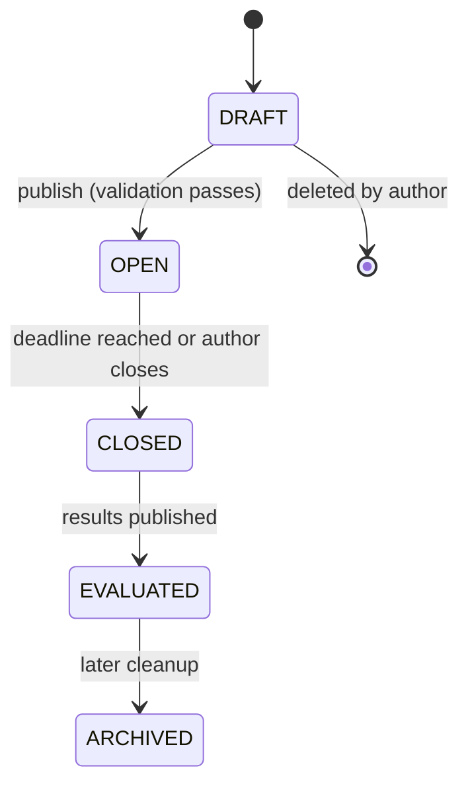

**Participation**

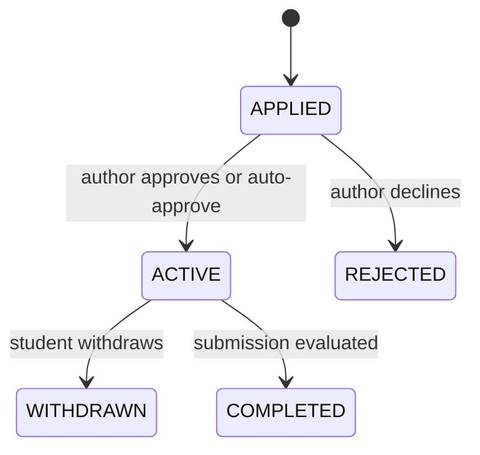

**Submission**

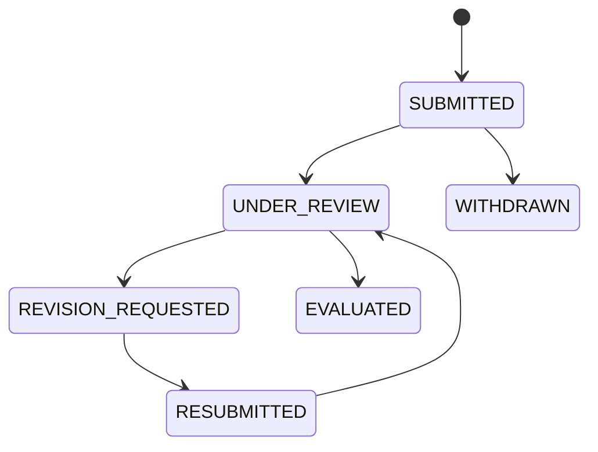

**Certificate**

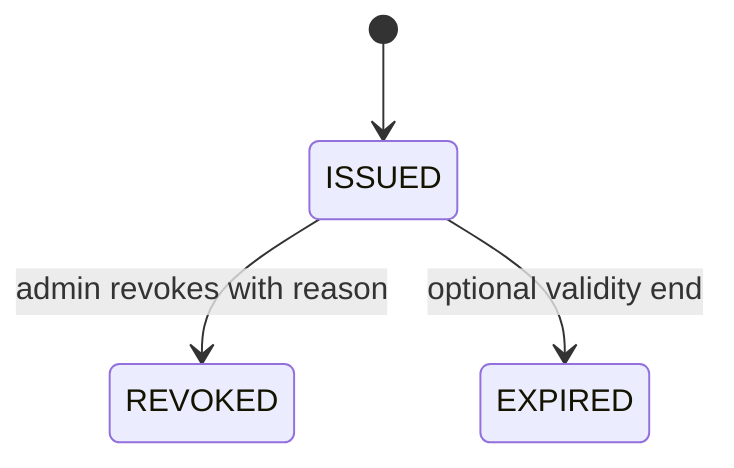

**Mentorship request**

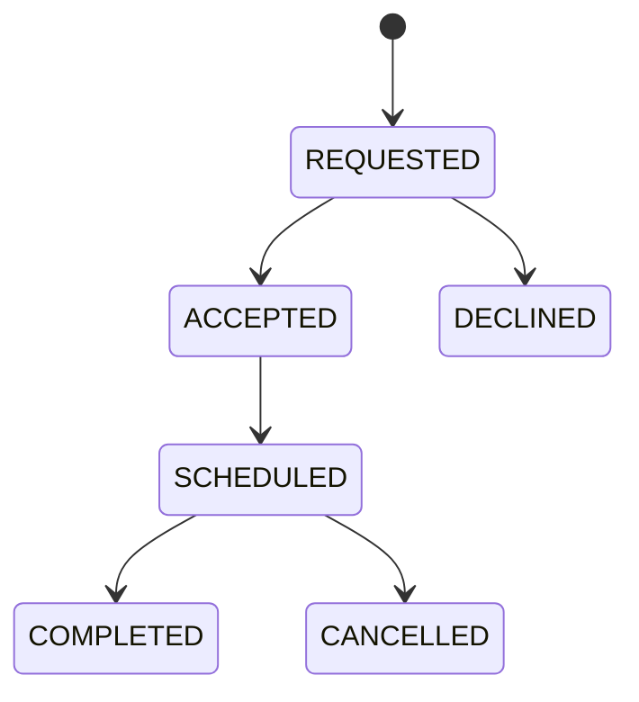

### 6.5 What must never happen

| Forbidden state | Guard |
|---|---|
| Submission without participation | Composite uniqueness + service check |
| Evaluation by a non-owner alumni | Ownership check in service layer |
| Certificate without an evaluated submission | Foreign key to evaluation + status check |
| Portfolio item visible without consent | Consent record required at query time |
| Company reading a private asset | Signed, short-lived URLs bound to a consent check |
| Two "top submission" flags for one challenge | Partial unique index / transaction |
| Certificate claiming university issuance | Fixed disclosure fields, non-editable template |

---

## 7. Functional Requirements

**Priority:** M = must (MVP demo breaks without it), S = should (MVP if time),
C = could (post-MVP), F = future.
**Scope:** MVP or Future.
**Roles:** A = alumni, S = student, AD = admin, C = company, Any = all signed-in users.

### 7.1 Accounts, authentication and access

| ID | Requirement | Role | Pri | Depends | Acceptance condition | Scope |
|---|---|---|---|---|---|---|
| FR-01 | A visitor can register as STUDENT or ALUMNI with name, email and password. | Any | M | — | Valid submission creates an UNVERIFIED user; duplicate email returns 409. | MVP |
| FR-02 | A company can register, landing in COMPANY_PENDING until an admin verifies it. | C | M | FR-01 | Pending company cannot search portfolios; verified company can. | MVP |
| FR-03 | Admin accounts are created only by invitation and never by public registration. | AD | M | FR-01 | Public registration with role ADMIN is rejected with 403. | MVP |
| FR-04 | Email verification is required before protected actions. | Any | M | FR-01 | Unverified user can browse public pages but cannot apply, submit or publish. | MVP |
| FR-05 | A user can log in and receive a short-lived access token plus a rotated refresh token. | Any | M | FR-04 | Wrong password returns 401 without revealing whether the email exists. | MVP |
| FR-06 | A user can log out, revoking the current refresh token. | Any | M | FR-05 | Reuse of the revoked token fails. | MVP |
| FR-07 | A user can request a password reset by email and set a new password. | Any | M | FR-05 | Reset token is single-use, expires, and invalidates other sessions. | MVP |
| FR-08 | Every protected API route enforces role and ownership on the server. | Any | M | FR-05 | Role matrix tests return 401/403 as specified. | MVP |
| FR-09 | An admin can suspend or reactivate an account with a reason. | AD | M | FR-08 | Suspended user's next request fails and refresh tokens are revoked. | MVP |
| FR-10 | Failed logins are rate-limited per account and per IP. | Any | M | FR-05 | 6th attempt within the window returns 429. | MVP |
| FR-11 | Sessions can be listed and revoked individually. | Any | S | FR-05 | Revoking a device blocks that refresh token only. | MVP |
| FR-12 | Optional multi-factor authentication. | Any | F | FR-05 | TOTP challenge required after password. | Future |

### 7.2 Profiles and the Alumni Data Hub

| ID | Requirement | Role | Pri | Depends | Acceptance condition | Scope |
|---|---|---|---|---|---|---|
| FR-13 | An alumni can create and edit a professional profile (graduation year, department, company, designation, industry, expertise, mentorship availability). | A | M | FR-05 | Profile saves with validation; incomplete required fields block challenge publishing. | MVP |
| FR-14 | A student can create and edit an academic/professional profile (department, year, bio, links). | S | M | FR-05 | Profile saves; public view hides email by default. | MVP |
| FR-15 | A company can create a company profile with name, website, industry and logo. | C | M | FR-02 | Profile is editable by the owner only; verification status is visible. | MVP |
| FR-16 | Skills are a controlled taxonomy reusable across profiles, challenges and search. | Any | M | FR-13 | The same skill row powers alumni filter, challenge tag and portfolio tag. | MVP |
| FR-17 | The alumni directory supports search by name, company, industry, graduation year and skill. | Any | M | FR-13 | Results are paginated and filter combinations are reflected in the URL. | MVP |
| FR-18 | Alumni can control field-level visibility (company, contact, mentorship). | A | M | FR-13 | A hidden field is absent from other users' payloads, not just hidden in CSS. | MVP |
| FR-19 | An admin can verify an alumni record and mark its source. | AD | M | FR-13 | Verified badge appears; audit entry records who verified and when. | MVP |
| FR-20 | An admin can import alumni records from a CSV with a dry-run report. | AD | S | FR-13 | Invalid rows are reported; no partial silent writes. | MVP |
| FR-21 | A user can upload an avatar/logo with type and size validation. | Any | S | FR-13 | Oversized or non-image files are rejected. | MVP |
| FR-22 | A user can request export or deletion of their personal data. | Any | S | FR-13 | Request is recorded; deletion anonymises work records rather than breaking them. | MVP |
| FR-23 | Alumni can mark supervision capacity and preferred challenge categories. | A | C | FR-13 | Capacity is shown when a student requests mentorship. | Future |

### 7.3 Challenge Hub and task delegation

| ID | Requirement | Role | Pri | Depends | Acceptance condition | Scope |
|---|---|---|---|---|---|---|
| FR-24 | An alumni can save a challenge as a draft. | A | M | FR-13 | Draft is private to the author and editable. | MVP |
| FR-25 | Publishing requires title, problem statement, deliverables, deadline and at least one skill. | A | M | FR-24 | Missing fields return field-level validation errors. | MVP |
| FR-26 | A challenge defines an evaluation rubric whose criteria total 100 points. | A | M | FR-24 | Saving a rubric totalling ≠100 is rejected. | MVP |
| FR-27 | A challenge can be marked paid or unpaid, with paid tasks requiring full terms. | A | M | FR-25 | Paid without terms cannot publish; both states render a visible label. | MVP |
| FR-28 | An author can edit a challenge until the first submission, then only append clarifications. | A | M | FR-25 | Editing locked fields after the first submission returns 409. | MVP |
| FR-29 | An author can close or archive a challenge; the system closes it automatically at the deadline. | A/System | M | FR-25 | Closed challenges reject new applications and submissions. | MVP |
| FR-30 | Anyone signed in can browse open challenges with pagination. | Any | M | FR-25 | Page size is capped; only OPEN/DRAFT-visible-to-author records appear. | MVP |
| FR-31 | Challenges can be filtered by skill, category, paid/unpaid, deadline and search text. | Any | M | FR-30 | Filters combine; count matches returned results. | MVP |
| FR-32 | A challenge detail page shows scope, skills, deliverables, deadline, rubric, terms and author. | Any | M | FR-30 | Every published challenge resolves at its slug; archived ones show a status banner. | MVP |
| FR-33 | A student can save a challenge for later. | S | S | FR-30 | Saved list is private and removable. | MVP |
| FR-34 | Participants can post questions and the author can answer them publicly. | Any/A | S | FR-25 | Answers are visible to all participants; author badge is shown. | MVP |
| FR-35 | The system prevents applications after the deadline even if the UI is bypassed. | System | M | FR-29 | Direct API call returns 409. | MVP |
| FR-36 | Challenge cards surface participant and submission counts. | Any | S | FR-30 | Counts are computed from real rows, never hard-coded. | MVP |
| FR-37 | Team-based challenges with named members and equal attribution. | A/S | F | FR-25 | Team submission appears once per challenge with member list. | Future |
| FR-38 | Recurring or multi-stage challenges. | A | F | FR-25 | Stage model with per-stage deadlines. | Future |

### 7.4 Participation and submission

| ID | Requirement | Role | Pri | Depends | Acceptance condition | Scope |
|---|---|---|---|---|---|---|
| FR-39 | A student can apply to an open challenge, creating a participation record. | S | M | FR-30, FR-35 | Duplicate application returns 409; status is APPLIED or ACTIVE. | MVP |
| FR-40 | A student can withdraw before submitting. | S | M | FR-39 | Withdrawal frees the slot and is recorded with a timestamp. | MVP |
| FR-41 | A student can submit a titled solution with links (repo, demo) and files. | S | M | FR-39 | Submission appears in the author's review queue immediately. | MVP |
| FR-42 | Submission assets are validated by type, size and count before storage. | S | M | FR-41 | Disallowed MIME types are rejected server-side. | MVP |
| FR-43 | Submission files are private: only the student, challenge author and admin can fetch them. | System | M | FR-42 | Unauthorised fetch returns 403; URLs expire. | MVP |
| FR-44 | A student can save a submission as a draft and edit it until the deadline. | S | M | FR-41 | Drafts are invisible to alumni; final submit locks content. | MVP |
| FR-45 | A student can track submission status through the defined states. | S | M | FR-41 | Status timeline matches the state machine. | MVP |
| FR-46 | Re-submission is allowed only when the author requests revision or policy permits. | S | M | FR-44 | Extra revisions are rejected after acceptance. | MVP |
| FR-47 | The system blocks submissions after the deadline unless the author grants an extension. | System | M | FR-29 | Late attempt returns 409 unless an extension record exists. | MVP |
| FR-48 | The student receives a confirmation with a submission reference. | S | S | FR-41 | Reference is stable and searchable by the student. | MVP |
| FR-49 | Version history is retained for every submission revision. | S | S | FR-46 | Previous versions are readable but not editable. | MVP |
| FR-50 | Virus/malware scanning hook on uploaded assets. | System | C | FR-42 | Infected file is quarantined and the upload fails with a clear message. | Future |
| FR-51 | Team submissions and member-level contribution notes. | S | F | FR-37 | Contribution notes appear with the submission. | Future |

### 7.5 Evaluation, ranking and feedback

| ID | Requirement | Role | Pri | Depends | Acceptance condition | Scope |
|---|---|---|---|---|---|---|
| FR-52 | Only the challenge author (or an admin moderator) can open the evaluation screen. | A/AD | M | FR-41 | Other alumni receive 403. | MVP |
| FR-53 | An evaluator scores each published rubric criterion within its maximum. | A | M | FR-26, FR-41 | Scores outside range are rejected; total is computed, not entered. | MVP |
| FR-54 | An evaluator records written feedback for each submission. | A | M | FR-53 | Empty feedback cannot be published as a completed evaluation. | MVP |
| FR-55 | An evaluator can request a revision with specific notes. | A | M | FR-53 | Submission returns to REVISION_REQUESTED and the student is notified. | MVP |
| FR-56 | Evaluations can be saved as draft before publishing. | A | S | FR-53 | Draft scores are invisible to the student. | MVP |
| FR-57 | Ranking is computed per challenge from total scores. | System | M | FR-53 | Ranks are unique per challenge and never global. | MVP |
| FR-58 | The author can flag at most one top submission per challenge. | A | M | FR-57 | A second flag moves the designation in a transaction. | MVP |
| FR-59 | Publishing results notifies every participant and freezes published scores. | A | M | FR-53 | Students see scores and feedback; edits require an explicit amendment. | MVP |
| FR-60 | Amendments after publication are versioned and audited with a reason. | A/AD | S | FR-59 | Students see an "updated" badge and the change history. | MVP |
| FR-61 | A student can raise a clarification/dispute request on a score. | S | S | FR-59 | Request is stored and visible to the author and admin; no silent edits. | MVP |
| FR-62 | Evaluation history per student is visible to that student only. | S | M | FR-59 | Other students and companies cannot read it. | MVP |
| FR-63 | Blind evaluation mode (hide student identity until scores are submitted). | A | F | FR-52 | Identity hidden in the queue until publication. | Future |

### 7.6 Appreciation certificates

| ID | Requirement | Role | Pri | Depends | Acceptance condition | Scope |
|---|---|---|---|---|---|---|
| FR-64 | An author can issue a certificate to an evaluated student submission. | A | M | FR-59 | Certificate cannot be issued for an unevaluated submission. | MVP |
| FR-65 | The certificate stores student display name, challenge title, recognised skills, issuer, issue date, certificate ID and score. | System | M | FR-64 | All fields render exactly as stored on the PDF and the verify page. | MVP |
| FR-66 | The system generates a downloadable PDF certificate. | System | M | FR-64 | PDF opens, contains the QR code and the disclosure text. | MVP |
| FR-67 | Each certificate has a public verification page reached by ID or QR. | Any | M | FR-64 | Page returns VALID with matching data, or REVOKED/UNKNOWN. | MVP |
| FR-68 | A SHA-256 hash of the canonical certificate payload is stored and re-verified. | System | M | FR-66 | Recomputation after any tampering fails validation. | MVP |
| FR-69 | An admin can revoke a certificate with a reason; the record remains resolvable. | AD | M | FR-64 | Verify page shows REVOKED and the reason; no deletion. | MVP |
| FR-70 | Every certificate displays that it is alumni appreciation, not an academic credential. | System | M | FR-66 | Disclosure is embedded in the PDF and page, not optional text. | MVP |
| FR-71 | Certificates appear in the student's portfolio only after the student adds them. | S | M | FR-64 | Issuing alone never publishes anything. | MVP |
| FR-72 | Certificate download links expire and are scoped to the owner. | System | S | FR-66 | Expired link returns 410. | MVP |
| FR-73 | Blockchain anchoring of certificate hashes. | System | F | FR-68 | Only hash + minimal metadata on-chain; verifier can compare. | Future |

### 7.7 Student portfolio

| ID | Requirement | Role | Pri | Depends | Acceptance condition | Scope |
|---|---|---|---|---|---|---|
| FR-74 | A completed, evaluated project can be added to the student's portfolio. | S | M | FR-59 | Only that student can create the item. | MVP |
| FR-75 | Portfolio items capture title, summary, skills, links, challenge reference and assets. | S | M | FR-74 | Item renders consistently in 2D and in the 3D lab. | MVP |
| FR-76 | Each item has an independent visibility setting. | S | M | FR-75 | Changing visibility changes company search results immediately. | MVP |
| FR-77 | The portfolio owner can preview exactly what a company sees. | S | M | FR-76 | Preview hides private fields and shows the consent state. | MVP |
| FR-78 | Alumni feedback and recommendations attached to the work are displayed. | System | M | FR-59 | Only published feedback appears; drafts never leak. | MVP |
| FR-79 | A portfolio has a shareable link that respects consent. | S | S | FR-76 | Anonymous access shows only public items. | MVP |
| FR-80 | Skill coverage and project count summaries are derived from real items. | S | S | FR-75 | No hard-coded totals. | MVP |
| FR-81 | Import external projects (e.g. GitHub) as unverified portfolio items. | S | C | FR-75 | Items are labelled "self-reported". | Future |

### 7.8 Company talent discovery

| ID | Requirement | Role | Pri | Depends | Acceptance condition | Scope |
|---|---|---|---|---|---|---|
| FR-82 | A verified company can search consented portfolios by skill, category and recency. | C | M | FR-76 | Results exclude any item without active consent. | MVP |
| FR-83 | Search results show demonstrated skills and project evidence, not grades. | C | M | FR-82 | No academic marks appear anywhere in recruiter payloads. | MVP |
| FR-84 | Opening a portfolio item writes an access log entry. | System | M | FR-82 | Log records company, student, item, timestamp. | MVP |
| FR-85 | A company can send an interview, internship or assessment invitation. | C | M | FR-82 | Invitation fails if direct-invite consent is off. | MVP |
| FR-86 | A student can accept or decline an invitation. | S | M | FR-85 | Response is visible to the sending company only. | MVP |
| FR-87 | Revoking consent removes the item from search and blocks new invitations. | S | M | FR-76 | Existing invitation records remain for audit, marked consent-revoked. | MVP |
| FR-88 | A company dashboard lists shortlisted students and sent invitations. | C | S | FR-85 | Company sees only its own pipeline. | MVP |
| FR-89 | Company analytics (views, invites, conversion). | C | C | FR-84 | Metrics are computed from access logs. | Future |

### 7.9 Mentorship and Knowledge Vault

| ID | Requirement | Role | Pri | Depends | Acceptance condition | Scope |
|---|---|---|---|---|---|---|
| FR-90 | An alumni can toggle mentorship availability and list expertise. | A | M | FR-13 | Only open mentors appear in student search. | MVP |
| FR-91 | A student can send a mentorship request with a topic and preferred time. | S | M | FR-90 | Duplicate open requests to the same mentor are blocked. | MVP |
| FR-92 | An alumni can accept, decline, or propose a new time. | A | M | FR-91 | State changes follow the mentorship state machine. | MVP |
| FR-93 | Accepted sessions create a scheduled record with notes and attendees. | Both | M | FR-92 | Session appears in both dashboards. | MVP |
| FR-94 | Alumni can publish approved resources to a Knowledge Vault. | A | S | FR-13 | Only approved resources are searchable; drafts stay private. | MVP |
| FR-95 | Signed-in users can search the Knowledge Vault by topic and skill. | Any | S | FR-94 | Results cite author and date. | MVP |
| FR-96 | Career talks are listed as events with a registration action. | AD/A | C | FR-93 | Event appears on the landing events section when published. | MVP |
| FR-97 | AI Alumni Twin answers from approved content with sources and AI disclosure. | Any | F | FR-94 | Never impersonates an alumnus; cites sources; refuses out-of-scope questions. | Future |

### 7.10 University engagement dashboard

| ID | Requirement | Role | Pri | Depends | Acceptance condition | Scope |
|---|---|---|---|---|---|---|
| FR-98 | The dashboard shows alumni totals, active alumni, challenges, participation, completions, mentorship sessions and certificates. | AD | M | FR-13, FR-59, FR-93 | Every number is a live query over real rows with a visible date window. | MVP |
| FR-99 | Engagement can be grouped by department, graduation year and industry. | AD | M | FR-98 | Filters update all widgets consistently. | MVP |
| FR-100 | An admin can review and moderate challenges and reported content. | AD | M | FR-25 | Moderation actions are audited and reversible where safe. | MVP |
| FR-101 | An admin can export an engagement report as CSV and PDF. | AD | M | FR-98 | Export includes the reporting window and a "demonstration data" label when seeded. | MVP |
| FR-102 | Administrators can manage roles and invitations. | AD | M | FR-03 | Role change is audited; last remaining admin cannot be demoted. | MVP |
| FR-103 | An audit log viewer shows privileged actions with filters. | AD | M | FR-09, FR-69, FR-102 | Admin reads of private records appear in the log. | MVP |
| FR-104 | Institutional comparison across multiple universities. | AD | F | FR-98 | Tenant-scoped reporting. | Future |

### 7.11 3D Metaverse Alumni Hub

| ID | Requirement | Role | Pri | Depends | Acceptance condition | Scope |
|---|---|---|---|---|---|---|
| FR-105 | A signed-in user can enter the virtual campus from the app. | Any | M | FR-05 | Route is lazy-loaded; unauthenticated users are redirected to login. | MVP |
| FR-106 | The lobby presents labelled entrances for all five spaces, with MVP spaces active. | Any | M | FR-105 | Inactive rooms are visibly marked "future", not broken. | MVP |
| FR-107 | Challenge Arena lists live open challenges from the same API as the 2D hub. | Any | M | FR-30 | A challenge created in 2D appears without reseeding. | MVP |
| FR-108 | Innovation Lab displays portfolio projects marked visible by their owner. | Any | M | FR-76 | Private items never appear in the 3D scene. | MVP |
| FR-109 | Clicking a challenge or project opens the corresponding normal page. | Any | M | FR-107 | Navigation uses the real route and preserves the return path. | MVP |
| FR-110 | A non-3D fallback directory provides every 3D entry point. | Any | M | FR-106 | Disabling WebGL leaves all actions reachable in 2D. | MVP |
| FR-111 | Camera/navigation works with mouse, touch and keyboard. | Any | M | FR-105 | Focus does not get trapped; Escape exits. | MVP |
| FR-112 | The scene has an asset and frame budget with graceful degradation. | System | S | FR-105 | Low-power devices receive reduced geometry/effects. | MVP |
| FR-113 | Multiplayer avatars, voice chat and a full campus. | Any | F | FR-105 | — | Future |
| FR-114 | Career Hall and Wall of Recognition rooms. | Any | F | FR-105 | Rooms read alumni/certificate data with consent. | Future |

### 7.12 Platform services

| ID | Requirement | Role | Pri | Depends | Acceptance condition | Scope |
|---|---|---|---|---|---|---|
| FR-115 | In-app notifications for participation, evaluation, certificate, invitation and mentorship events. | Any | M | FR-41 | Unread count is accurate; opening a notification marks it read. | MVP |
| FR-116 | Transactional email for verification, reset and key status changes. | Any | M | FR-04 | Local dev logs the message; production sends it. | MVP |
| FR-117 | Every privileged mutation writes an audit entry. | System | M | FR-08 | Entry includes actor, action, target, before/after summary. | MVP |
| FR-118 | An admin can reseed demonstration data in non-production environments only. | AD | S | FR-98 | Command is blocked when `NODE_ENV=production`. | MVP |
| FR-119 | A health endpoint reports API and database status without leaking secrets. | System | M | — | Returns status and counts only. | MVP |
| FR-120 | Notification preferences (email vs in-app per category). | Any | C | FR-115 | Preferences respected by the dispatcher. | Future |

---

## 8. Non-Functional Requirements

Each NFR states the requirement, why it matters, and what it changes in the
implementation. Targets are design commitments, not measured results.

| ID | Category | Requirement | Implementation impact | Verification |
|---|---|---|---|---|
| NFR-01 | Security | Passwords are stored only as bcrypt hashes (cost ≥ 12). No plaintext or reversible storage. | Auth service hashing; password never logged. | Code review + DB inspection. |
| NFR-02 | Security | Access tokens are short-lived (≤ 30 min) and refresh tokens rotate and are stored hashed. | Token service + `refresh_tokens` table. | Reuse detection test. |
| NFR-03 | Security | All mutations validate input with a schema (Zod) and reject unknown fields. | Shared validation layer per route. | Invalid payload test suite. |
| NFR-04 | Security | Rate limits apply to auth, uploads, invitations and verification lookups. | In-memory/Redis limiter per route group. | 429 behaviour test. |
| NFR-05 | Security | Uploaded files are validated by MIME, extension, size and count; stored outside the web root. | Storage adapter with checks; signed URLs. | Malicious-file test. |
| NFR-06 | Security | Security headers (CSP, HSTS, X-Content-Type-Options, frame-ancestors) are set in production. | Helmet or equivalent. | Header inspection. |
| NFR-07 | Privacy | Students control portfolio visibility per item and can revoke consent at any time. | Consent records + query-level filtering. | Consent matrix test. |
| NFR-08 | Privacy | Companies receive only consented fields; access is logged. | Separate recruiter DTO + access log. | Payload inspection. |
| NFR-09 | Privacy | Private submissions never become public automatically. | Portfolio creation is explicit and owned by the student. | Negative test. |
| NFR-10 | Privacy | Personal data and private files are never written to a blockchain. | Only certificate hashes may be anchored, future. | Design review. |
| NFR-11 | RBAC | Authorisation is enforced server-side on every protected route. | `requireRole` + ownership guards. | Role matrix tests. |
| NFR-12 | Performance | Landing page LCP < 2.5 s on a mid-range mobile profile; API p95 < 400 ms for list endpoints. | Code splitting, lazy 3D, indexed queries, pagination. | Lighthouse + timing logs. |
| NFR-13 | Performance | 3D scene loads only on its route and keeps a frame budget on integrated GPUs. | Dynamic import + reduced-quality fallback. | Device check + frame timing. |
| NFR-14 | Scalability | List endpoints are paginated and DB queries use indexes for their filters. | Cursor/offset pagination with caps. | Query plan review. |
| NFR-15 | Scalability | Stateless API instances; sessions live in tokens/DB, not process memory. | No in-process session store. | Restart test. |
| NFR-16 | Accessibility | WCAG 2.1 AA: contrast, focus visibility, labels, keyboard operation, reduced motion. | Design tokens + focus styles + semantics. | Axe scan + manual keyboard pass. |
| NFR-17 | Responsiveness | Usable from 360 px to 1440 px without horizontal scrolling. | Fluid type, breakpoint-specific layouts. | Six-width browser audit. |
| NFR-18 | Reliability | Failed certificate generation or email never leaves a half-written state. | Transactional writes + retry/outbox. | Failure injection. |
| NFR-19 | Reliability | Health endpoint distinguishes API up from database up. | `/api/health` checks a trivial query. | Kill DB test. |
| NFR-20 | Maintainability | Modules separated by domain; shared types for request/response contracts. | Service/repository folders + shared DTOs. | Lint/type-check gate. |
| NFR-21 | Maintainability | Database changes are migrations, never manual edits. | Prisma migrate in CI. | Migration diff check. |
| NFR-22 | Compatibility | Latest two versions of Chrome, Edge, Firefox, Safari; iOS Safari 16+. | No unsupported APIs without fallback. | Browser matrix. |
| NFR-23 | Data integrity | Foreign keys, uniqueness constraints and transactions protect the challenge → submission → evaluation → certificate chain. | Schema constraints + service transactions. | Constraint tests. |
| NFR-24 | Data integrity | Rankings and "top submission" are unique per challenge. | Composite/partial unique indexes. | Concurrency test. |
| NFR-25 | Usability | Every empty, loading, error and permission-denied state has a designed message. | Shared UI state components. | UX review. |
| NFR-26 | Availability | Public certificate verification must work without authentication and degrade read-only. | Separate public route + cache headers. | Unauthenticated check. |
| NFR-27 | Auditability | Privileged actions and admin reads of private data are recorded with actor, time and target. | `audit_logs` middleware. | Log inspection. |
| NFR-28 | Observability | Errors are logged with request id; no secrets or personal data in logs. | Structured logger + redaction. | Log sample review. |
| NFR-29 | Content integrity | Demonstration data is labelled everywhere it appears (UI, exports, 3D). | `isDemo` flag + badge component. | Visual/content audit. |
| NFR-30 | Legal/trust | Certificate and ranking copy avoids employment or accreditation guarantees. | Fixed disclosure strings reviewed in one place. | Copy audit. |

---

## 9. Functional Modules

### 9.0 Source-to-delivery module mapping

The source PDF defines **8 modules**. This plan delivers **11** so that
submission, evaluation, portfolio and company discovery can be built and tested
independently. The original names and concepts are preserved. **[SRC] → [PROP] split**

| Source module (PDF) | Delivery module(s) in this plan | Why split |
|---|---|---|
| 1. Centralized Alumni Data Hub | M1 | unchanged |
| 2. Alumni Challenge Hub | M2 (+ M6 task delegation) | Paid task terms need their own lifecycle and validation |
| 3. Student Submission and Evaluation | M3 + M4 | Submission is student-owned; evaluation is alumni-owned; different permissions and states |
| 4. Alumni Appreciation and Digital Certificates | M5 | unchanged |
| 5. Task Delegation and Rewards | M6 | unchanged |
| 6. Student Skill Portfolio and Company Discovery | M7 + M8 | Portfolio is student-controlled; discovery is company-facing with consent gating |
| 7. Mentorship and Knowledge Vault | M9 | unchanged |
| 8. University Engagement Dashboard | M10 | unchanged |
| (signature feature) 3D Metaverse Alumni Hub | M11 | unchanged |

### M1 — Centralized Alumni Data Hub

| Aspect | Detail |
|---|---|
| Purpose | Replace fragmented alumni records with one structured, searchable, permissioned source. **[SRC]** |
| Main features | Alumni profiles (graduation year, department, company, designation, industry, expertise, skills, mentorship availability); field-level visibility; directory search and filters; admin verification; CSV import; profile completeness. |
| Users | Alumni (owner), students and companies (read, permissioned), admins (manage/verify). |
| Inputs | Profile form, skill tags, avatar, CSV import file, verification decision. |
| Outputs | Directory results, profile pages, verified badges, alumni counts for analytics. |
| Data | `users`, `alumni_profiles`, `student_profiles`, `skills`, `profile_skills`, `consent_records`. |
| Services | Profile service, directory search, verification service, import service. |
| Pages | `/alumni`, `/alumni/:id`, `/dashboard/profile`, `/admin/alumni`. |
| Depends on | Auth (M0), skills taxonomy. |
| Feeds | Challenges (author identity), mentorship matching, university analytics, 3D Career Hall (future). |
| Scope | MVP: profiles, search, visibility, verification. Future: rich experience timelines, endorsements. |

### M2 — Alumni Challenge Hub

| Aspect | Detail |
|---|---|
| Purpose | Let alumni turn real industry problems into scoped, evaluable student work. **[SRC]** |
| Main features | Draft/publish, skills, deliverables, deadline, submission format, rubric, eligibility, paid/unpaid flag, category, clarifications, close/archive, automatic deadline closing. |
| Users | Alumni (author), students (browse), admins (moderate). |
| Inputs | Challenge form, rubric criteria, paid-task terms, attachments/brief. |
| Outputs | Published challenge, detail page, filters, counts, participant list. |
| Data | `challenges`, `challenge_skills`, `evaluation_criteria`, `challenge_questions`, `challenge_participants`. |
| Services | Challenge service, rubric validation, scheduler for deadline close, search. |
| Pages | `/hub`, `/hub/:slug`, `/dashboard/challenges/new`, `/dashboard/challenges/:id`. |
| Depends on | M1 (author profile), M0. |
| Feeds | M3 (participation), M6 (delegation), M10 analytics, M11 arena. |
| Scope | MVP: single-stage challenges. Future: team/multi-stage, templates. |

### M3 — Student Participation and Submission

| Aspect | Detail |
|---|---|
| Purpose | Give students a reliable way to join work and deliver evidence. **[SRC]** |
| Main features | Apply/join, withdraw, draft submission, file and link submission, versioning, status timeline, deadline enforcement, private asset access. |
| Users | Students (owner), alumni (author read), admins (audit). |
| Inputs | Participation action, submission form, files (PDF, ZIP, images, video links), repository/demo URLs. |
| Outputs | Participation record, submission with assets, status timeline, review queue entry. |
| Data | `challenge_participants`, `submissions`, `submission_assets`, `submission_versions`. |
| Services | Participation service, upload service (validation + storage), submission service. |
| Pages | `/hub/:slug` (apply), `/dashboard/submissions`, `/dashboard/submissions/:id`. |
| Depends on | M2, M0, storage adapter. |
| Feeds | M4 (evaluation queue), M7 (portfolio source), M10 analytics, M11 arena. |
| Scope | MVP: individual submissions. Future: teams, malware scanning, inline previews. |

### M4 — Alumni Evaluation and Feedback

| Aspect | Detail |
|---|---|
| Purpose | Produce transparent, criteria-based, challenge-scoped judgement of work. **[SRC]** |
| Main features | Rubric scoring, written feedback, revision requests, draft/publish, ranking, top submission, amendments with history, student dispute note. |
| Users | Challenge author (evaluator), student (recipient), admin (moderator). |
| Inputs | Criterion scores, comments, revision notes, publish action. |
| Outputs | Evaluation record, total score, rank, published feedback, eligibility for certificate. |
| Data | `evaluations`, `evaluation_scores`, `evaluation_amendments`. |
| Services | Evaluation service, ranking transaction, notification dispatcher. |
| Pages | `/dashboard/review/:challengeId`, `/dashboard/submissions/:id/result`. |
| Depends on | M3, M2 rubric. |
| Feeds | M5 certificates, M7 portfolio, M10 analytics, M11 Wall of Recognition (future). |
| Scope | MVP: single evaluator per challenge. Future: multi-reviewer panels, blind review. |

### M5 — Alumni Appreciation Certificates

| Aspect | Detail |
|---|---|
| Purpose | Give deserved recognition a durable, verifiable artefact that is clearly not a university credential. **[SRC]** |
| Main features | Issue, PDF, QR, public verify, SHA-256 hash, revoke with reason, disclosure text, owner-scoped download. |
| Users | Alumni (issuer), student (recipient), public verifier, admin (revoke). |
| Inputs | Evaluation reference, recognised skills, issuer details, template. |
| Outputs | PDF, certificate record, QR URL, verification page result. |
| Data | `certificates`, `certificate_verifications` (optional log). |
| Services | Certificate service, PDF renderer, QR generator, hashing utility, verify endpoint. |
| Pages | `/verify/:certificateId`, `/dashboard/certificates`. |
| Depends on | M4 (evaluated submission), M1 (issuer identity). |
| Feeds | M7 portfolio, M10 analytics, M11 Wall of Recognition (future). |
| Scope | MVP: PDF + QR + hash. Future: blockchain anchor, templates, bulk issue. |

### M6 — Task Delegation and Rewards

| Aspect | Detail |
|---|---|
| Purpose | Support scoped paid/unpaid work that is not necessarily a public challenge. **[SRC]** |
| Main features | Paid/unpaid label, terms (scope, deliverables, deadline, payment amount, revisions, ownership, acceptance), student selection, completion confirmation, reward tracking (no money movement). |
| Users | Alumni (delegator), students (applicants/assignee), admin (moderation). |
| Inputs | Task terms, applicant list, selection decision, completion confirmation. |
| Outputs | Task record, agreement snapshot, completion record, optional certificate. |
| Data | `tasks`, `task_applications`, `task_terms`, `reward_records`. |
| Services | Task service, terms validation, agreement snapshot. |
| Pages | `/tasks`, `/tasks/:id`, `/dashboard/tasks`. |
| Depends on | M1, M3 (submission reuse or lightweight variant). |
| Feeds | M5 (recognition), M7 (portfolio), M10 analytics. |
| Scope | MVP: terms + tracking. Future: payments, contracts, escrow. |

### M7 — Student Skill Portfolio

| Aspect | Detail |
|---|---|
| Purpose | Turn completed work into credible, consented evidence of skill. **[SRC]** |
| Main features | Add evaluated work, manual items, skill tags, per-item visibility, public link, feedback display, certificate display, preview-as-company. |
| Users | Students (owner), companies (consented read), alumni (feedback author), admins (audit). |
| Inputs | Submission reference, summary, links, skills, consent choices. |
| Outputs | Portfolio page, public link, searchable consented items. |
| Data | `portfolio_items`, `portfolio_item_skills`, `consent_records`. |
| Services | Portfolio service, consent service, public view renderer. |
| Pages | `/p/:handle`, `/dashboard/portfolio`, `/dashboard/portfolio/:id`. |
| Depends on | M3/M4 (source work), M5 (certificate display). |
| Feeds | M8 discovery, M10 analytics, M11 Innovation Lab. |
| Scope | MVP: challenge-derived items + manual items. Future: verified external work. |

### M8 — Company Talent Discovery

| Aspect | Detail |
|---|---|
| Purpose | Let companies find demonstrated skill without exposing student data. **[SRC]** |
| Main features | Company verification, consented search, skill filters, limited recruiter view, access logs, invitations, responses. |
| Users | Companies, students (consent), admins (verification, audit). |
| Inputs | Search filters, portfolio view, invitation content. |
| Outputs | Result sets, invitation records, access log, pipeline. |
| Data | `company_profiles`, `company_access_logs`, `opportunities`, `opportunity_responses`. |
| Services | Discovery service, consent guard, invitation service. |
| Pages | `/company/search`, `/company/pipeline`, `/company/profile`. |
| Depends on | M7, M1 (company profile). |
| Feeds | M10 analytics (aggregate, non-identifying). |
| Scope | MVP: search + invite. Future: assessments, analytics, ATS integration. |

### M9 — Mentorship and Knowledge Vault

| Aspect | Detail |
|---|---|
| Purpose | Structure alumni guidance and preserve approved knowledge. **[SRC]** |
| Main features | Mentor availability, requests, accept/decline/reschedule, session records, notes, approved resources, search, career talks. |
| Users | Alumni mentors, students, admins (moderation). |
| Inputs | Availability, request topic, session notes, resource files/links. |
| Outputs | Session records, searchable vault entries, event listings. |
| Data | `mentorship_requests`, `mentorship_sessions`, `knowledge_resources`, `events`. |
| Services | Mentorship service, resource moderation, search. |
| Pages | `/mentorship`, `/mentorship/:id`, `/dashboard/mentorship`, `/vault`. |
| Depends on | M1 (expertise), M0. |
| Feeds | M10 analytics, M11 Mentorship Room (future), portfolio (optional outcomes). |
| Scope | MVP: requests + sessions + approved resources. Future: AI Twin, scheduling integrations. |

### M10 — University Engagement Dashboard

| Aspect | Detail |
|---|---|
| Purpose | Give administrators one truthful view of alumni engagement and collaboration. **[SRC]** |
| Main features | Alumni totals, active alumni, challenges, participation, completions, mentorship, certificates, department breakdowns, date windows, CSV/PDF export, moderation. |
| Users | Admins. |
| Inputs | Date range, department, graduation year, report type. |
| Outputs | Dashboard widgets, charts, export files, audit entries. |
| Data | Read-only aggregates over M1–M9 tables; `audit_logs`; `reports`. |
| Services | Analytics service (SQL aggregates), export service. |
| Pages | `/admin`, `/admin/alumni`, `/admin/challenges`, `/admin/reports`. |
| Depends on | M1, M2, M3, M4, M5, M9. |
| Feeds | Institutional reporting; no write-back to other modules. |
| Scope | MVP: fixed widgets + exports. Future: multi-university comparison, scheduled reports. |

### M11 — 3D Metaverse Alumni Hub

| Aspect | Detail |
|---|---|
| Purpose | Make the ecosystem explorable and memorable without creating a second product. **[SRC]** |
| Main features | Lobby, Challenge Arena, Innovation Lab, clickable navigation into real pages, 2D fallback, reduced-quality mode. |
| Users | All signed-in roles (companies read-only). |
| Inputs | Session, challenge list, approved portfolio items, room selection. |
| Outputs | Interactive scene state, deep links to real routes. |
| Data | No separate store: reads M2, M5 (future), M7, M1 (future). |
| Services | Reuses existing REST endpoints; scene-specific aggregation endpoint optional. |
| Pages | `/campus` (lazy), `/campus/arena`, `/campus/lab`. |
| Depends on | M2, M7, M0. |
| Feeds | Entry into M3, M7, M5 (future). |
| Scope | MVP: lobby + 2 rooms. Future: Career Hall, Mentorship Room, Wall of Recognition, avatars, voice. |

---

## 10. MVP Scope and Prioritisation

### 10.1 MoSCoW summary

| Priority | Contents |
|---|---|
| **Must** | Auth + RBAC; profiles; challenge create/publish/browse; participation; submission with private files; rubric evaluation + feedback + challenge ranking; certificate PDF + QR verify + hash; portfolio with consent; admin dashboard (read); 3D lobby + Arena + Lab; audit log; seed data. |
| **Should** | Draft submissions, revision requests, dispute note, CSV alumni import, mentorship requests/sessions, knowledge resources, CSV/PDF export, save-for-later, Q&A. |
| **Could** | Company pipeline, portfolio share link, session management, notification preferences. |
| **Won't (this release)** | Payments, AI Twin, blockchain, multiplayer, VR, full campus, mobile apps, multi-university tenancy. |

### 10.2 The one workflow that must work end to end **[SRC]**

```
Alumni creates challenge → Student joins and submits → Alumni evaluates with rubric
→ Certificate issued → QR verification returns VALID → Portfolio shows the work
```

If time runs short, this chain is protected before any other feature. A working
chain with modest UI beats many half-built modules. **[SRC]**

### 10.3 Demo narrative (2–3 minutes) **[SRC]**

1. **Problem framing (15 s):** alumni knowledge is fragmented; students lack real projects.
2. **Enter the campus (20 s):** 3D lobby → Challenge Arena → select "Customer Complaint Analyzer" → land on the real challenge page.
3. **Alumni publishes (30 s):** show the form and the rubric (Problem-solving 40, Functionality 30, Creativity 20, Documentation 10).
4. **Student submits (30 s):** Aditi's prototype, repository link and demo.
5. **Alumni evaluates (30 s):** scores 92/100, feedback, top submission, ranking.
6. **Recognition (25 s):** certificate PDF with QR; scan → verification page shows VALID and the disclosure that this is alumni appreciation, not a university credential.
7. **Portfolio + company (25 s):** Aditi publishes the item; a company searches the skill and sends an invitation; state clearly that this is an opportunity, not a job guarantee.

All names, scores and records in the demo are **labelled demonstration data**,
including the 92/84/76 figures from the source scenario. **[SRC]**

### 10.4 Definition of done for the MVP

- The chain in 10.2 passes from a clean database with seeded demo users.
- Every list is paginated and every action has loading/empty/error states.
- RBAC negative tests pass for all four roles.
- Certificate verification works in a private window without login.
- Consent-off portfolio items are absent from company search payloads.
- 3D entry points all have a 2D equivalent.
- No console errors; no horizontal overflow at six widths.

---

## 11. Future Scope

| Enhancement | Why it is deferred | Prerequisite |
|---|---|---|
| Full company talent discovery and pipeline analytics | Needs mature consent + portfolio data to be meaningful | M7, M8 |
| Integrated online payments | Legal/compliance and reconciliation work far exceeds hackathon scope **[SRC]** | M6, finance review |
| Advanced mentorship scheduling (calendar, reminders, rescheduling) | Email/calendar integration and timezone handling | M9 |
| Knowledge Vault with AI retrieval | Requires a curated corpus and evaluation | M9 |
| AI Alumni Twin | Must be grounded in alumni-approved content and clearly labelled **[SRC]** | M9 + corpus |
| Blockchain certificate anchoring | Only hash + minimal metadata; privacy constraints **[SRC]** | M5 |
| Multiplayer avatars and voice | Real-time infrastructure, moderation, cost | M11 |
| Full virtual campus (Career Hall, Mentorship Room, Wall of Recognition) | Asset production time | M11 |
| Advanced event management | Not on the critical collaboration path | M9 |
| Multi-university tenancy | Schema and permission complexity | M10 |

---

## 12. 3D Metaverse Requirements

### 12.1 Spaces and their data sources **[SRC]**

| Space | What users do | Reads from | MVP |
|---|---|---|---|
| Central Lobby | Orient, choose a space, see campus map | static + session | **Yes** |
| Alumni Challenge Arena | Browse active challenges, deadlines, skills, status; open the real challenge page | M2 `/api/challenges` | **Yes** |
| Innovation Lab | Explore approved student projects; alumni can express interest | M7 consented portfolio items | **Yes** |
| Career Hall | Explore alumni booths by industry/expertise; open profiles; request mentorship | M1 directory, M9 | Future |
| Mentorship Room | Join scheduled sessions; view agenda and participants | M9 sessions | Future |
| Wall of Recognition | Show consented appreciation records and highlights | M5 certificates with consent | Future |

### 12.2 Technical requirements

| Requirement | Detail |
|---|---|
| Rendering | React Three Fiber (Three.js) in the existing React app. **[DEC]** No Unity WebGL in this build. |
| Loading | Route-level dynamic import; initial 3D bundle must not affect landing-page LCP. |
| Navigation | Click/keyboard/touch movement between lobby and rooms; pointer lock is optional and must be escapable. |
| Data | Same REST endpoints and session as 2D; no duplicated seed data. |
| Fallback | If WebGL is unavailable or the device is low-power, render the 2D campus directory with identical links. |
| Performance | Target ≤ 60k triangles for the MVP scene, one baked texture atlas, no realtime shadows on low tier. |
| Accessibility | Room list available as semantic HTML; visible focus; Escape exits; no audio required. |
| Consent | Portfolio items appear only when the owner allowed public/company visibility; certificate wall requires explicit consent. |
| Honesty | Future rooms are labelled "Future expansion", never fake-functional. |

### 12.3 Room-to-route contract

| In-scene object | Action | Destination |
|---|---|---|
| Challenge board | Select challenge | `/hub/:slug` |
| Lab display | Select project | `/p/:handle#item-:id` |
| Career booth (future) | Select alumni | `/alumni/:id` |
| Recognition panel (future) | Select certificate | `/verify/:certificateId` |
| Mentorship desk (future) | Request session | `/mentorship` |

### 12.4 Acceptance criteria

- A challenge created in the 2D app appears in the Arena without restarting or reseeding.
- A private portfolio item never renders in the Lab, verified by DOM/scene inspection.
- Every room click reaches a real page and the browser Back button returns to the campus.
- With WebGL disabled, the fallback lists the same rooms and links.
- Keyboard-only users can enter, choose a room, and leave.

---

## 13. Data, Privacy and Trust Requirements

These twelve rules are binding. Each is paired with the mechanism that enforces
it, so a later phase cannot quietly drop it. **[SRC]** for rules 1–12.

| # | Rule | Enforcement mechanism | Verified by |
|---|---|---|---|
| 1 | Passwords are protected with secure hashing. | bcrypt cost 12; hash never returned by any endpoint. | DB inspection, payload tests. |
| 2 | Access is role-based. | `requireRole` + ownership guards on every protected route. | Role matrix test suite. |
| 3 | Students control portfolio visibility. | Per-item visibility + `consent_records`; queries filter by active consent. | Company search payload test. |
| 4 | Companies see only permitted student information. | Recruiter DTO built from consented fields; no direct model exposure. | DTO review + negative test. |
| 5 | Private submissions never become public automatically. | Portfolio items are created explicitly by the student, never by evaluation. | Attempt to read unevaluated item as company → 404. |
| 6 | Appreciation certificates are not official academic credentials. | Fixed disclosure text in the PDF template and verify page; no university seal or wording. | Copy audit. |
| 7 | Rankings are challenge-specific, not measures of overall ability. | `evaluations` scope to `challenge_id`; no global student ranking endpoint. | API inventory review. |
| 8 | Paid and unpaid tasks are clearly distinguished. | `isPaid` required; visible badge on card, detail, submission and certificate. | UI audit at all entry points. |
| 9 | Paid tasks specify scope, deadlines, deliverables, payment terms, revisions, ownership and acceptance criteria. | Publish validation blocks paid tasks missing any term; terms snapshot stored. | Validation tests. |
| 10 | The MVP may record agreed payment terms without processing money. | `reward_records` stores terms and status; no payment SDK. | Dependency inventory. |
| 11 | AI Alumni Twin identifies itself as AI and uses approved information only. | Future: system prompt + visible label + source citations + refusal path. | Not built in MVP. |
| 12 | Personal data and sensitive files are never stored on a public blockchain. | Only a certificate hash may be anchored, and only in a future phase. | Design review. |

### 13.1 Additional privacy controls **[PROP]**

- **Data minimisation:** company payloads exclude email, phone, marks and files
  unless the student enabled the corresponding consent.
- **Right to withdraw:** deleting a portfolio item or revoking consent takes effect
  on the next query; cached public pages revalidate.
- **Deletion semantics:** deleting a user anonymises authored work
  (`author_display = "Deleted user"`) instead of cascading evidence away, so other
  students' certificates remain verifiable.
- **Logging hygiene:** logs record IDs, not names, emails or file contents.
- **Demo labelling:** seeded records carry `isDemo = true`; UI and exports render
  "Demonstration data".
- **Upload privacy:** submission buckets are private; access uses signed URLs with
  short TTL bound to an authorisation check.
- **Certificate visibility:** the verify page is public by design, but shows only
  name, challenge, skills, issuer, date and status — no contact details or score
  breakdown unless the student opted in.

---

## 14. Technical Stack

### 14.1 Confirmed direction **[DEC]**

| Layer | Choice | Notes |
|---|---|---|
| Frontend | React + TypeScript + Vite | Existing `apps/web`; Vite 5, React 18.3. |
| Styling | Tailwind CSS | Existing tokens and component classes. |
| Motion | GSAP + ScrollTrigger (landing) | Existing; one owner per animated element. |
| 3D | React Three Fiber / Three.js | Lazy-loaded route for `/campus`. |
| Backend | Node.js + Express | Existing `apps/api`. |
| ORM | Prisma | Existing; migrations committed. |
| Database | PostgreSQL (target), SQLite (local dev) | Provider swap + enum conversion; no provider-specific features until the swap. |
| Auth | bcrypt + JWT access token + rotated refresh token | httpOnly cookie for refresh; short-lived access token. |
| Validation | Zod schemas shared per route | Reject unknown fields. |
| Files | Private disk adapter (dev) → Cloudinary/S3-compatible (deploy) | Same interface; signed access. |
| PDF | pdf-lib or PDFKit | Server-side generation only. |
| QR | `qrcode` package | Encodes the public verification URL. |
| Hashing | Node `crypto` SHA-256 over a canonical JSON payload | Stored per certificate. |
| Email | Nodemailer with console transport in dev | Verification, reset, notifications. |
| Testing | Vitest + Supertest (API), Playwright or Puppeteer (E2E) | Added in Phase 15 hardening; smoke checks earlier. |
| Tooling | VS Code, Git, GitHub, Postman, Figma | As specified. |

### 14.2 PostgreSQL transition plan **[PROP]**

1. Keep `String` status/role columns while on SQLite; centralise allowed values in
   one constants module.
2. Before production: change `provider` to `postgresql`, convert role/status to
   Prisma enums, add `@db.Text` where long content is expected.
3. Replace any SQLite-only defaults; verify indexes and unique constraints.
4. Run the same seed and E2E chain against PostgreSQL in CI.
5. No data migration is expected for MVP tables because development data is
   disposable demo data.

### 14.3 Explicitly excluded from the stack

No microservices, no GraphQL, no Redux (local state + fetch is sufficient), no
separate admin app, no payment SDK, no AI service, no blockchain SDK in the MVP.
Each would add integration risk without supporting the demo chain. **[PROP]**

---

## 15. System Architecture

### 15.1 Three layers

```mermaid
flowchart LR
    subgraph P["Presentation layer"]
        LP["Public landing"]
        SD["Student dashboard"]
        AD["Alumni dashboard"]
        CD["Company dashboard"]
        XD["Admin dashboard"]
        M3D["3D campus (R3F)"]
    end

    subgraph A["Application layer (Express)"]
        AUTH["Auth service"]
        PROF["Profile service"]
        CH["Challenge service"]
        SUB["Submission service"]
        EVAL["Evaluation service"]
        CERT["Certificate service"]
        PORT["Portfolio service"]
        DISC["Discovery service"]
        MENT["Mentorship service"]
        AN["Analytics service"]
    end

    subgraph D["Data layer"]
        PG[("PostgreSQL")]
        FS[["Private object storage"]]
        MAIL[["Email transport"]]
    end

    P -->|"HTTPS JSON + session"| A
    A -->|"Prisma"| PG
    A -->|"signed access"| FS
    A --> MAIL
```

**In plain language.** The browser never talks to the database. Every screen calls
an Express endpoint with the user's access token. Express resolves the identity,
checks the role and ownership, validates input, calls a domain service, and only
then reads or writes through Prisma. File bytes go to private storage, while the
database stores metadata and access rules. Responses are JSON DTOs shaped for the
screen that asked — no raw Prisma objects are returned.

### 15.2 Request lifecycle

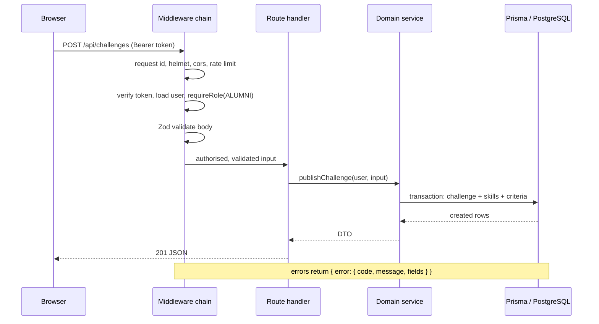

### 15.3 Middleware order (fixed)

1. request id + structured logger
2. security headers
3. CORS with the configured web origin
4. body parser with size limit
5. rate limiter (route-group specific)
6. authentication (attach `req.user`)
7. authorisation (`requireRole`, `requireOwner`, `requireConsent`)
8. schema validation
9. handler
10. not-found
11. central error handler (never leaks stack traces in production)

### 15.4 Planned API surface **[PROP]**

Existing endpoints already implemented: `GET /api/health`, `GET /api/challenges`,
`GET /api/stats`.

| Group | Endpoints | Access |
|---|---|---|
| Auth | `POST /api/auth/register`, `/login`, `/logout`, `/refresh`, `/verify-email`, `/forgot-password`, `/reset-password` | public (rate-limited) |
| Me | `GET/PATCH /api/me`, `GET /api/me/sessions`, `DELETE /api/me/sessions/:id` | any signed-in |
| Profiles | `GET /api/alumni`, `GET /api/alumni/:id`, `PATCH /api/profile/alumni`, `PATCH /api/profile/student`, `GET/PATCH /api/profile/company` | mixed, permissioned |
| Skills | `GET /api/skills`, `POST /api/admin/skills` | read public, write admin |
| Challenges | `GET /api/challenges`, `GET /api/challenges/:slug`, `POST /api/challenges`, `PATCH /api/challenges/:id`, `POST /api/challenges/:id/close`, `POST /api/challenges/:id/archive` | read public, write author |
| Participation | `POST /api/challenges/:id/participate`, `DELETE /api/participation/:id`, `GET /api/me/participations` | student |
| Submissions | `POST /api/challenges/:id/submissions`, `PATCH /api/submissions/:id`, `GET /api/submissions/:id`, `POST /api/submissions/:id/submit`, `GET /api/submissions/:id/assets/:assetId` | owner/author/admin |
| Evaluation | `GET /api/challenges/:id/review-queue`, `POST /api/submissions/:id/evaluations`, `POST /api/evaluations/:id/publish`, `POST /api/submissions/:id/top` | challenge author |
| Certificates | `POST /api/submissions/:id/certificate`, `GET /api/certificates/:id/pdf`, `GET /api/verify/:publicId`, `POST /api/admin/certificates/:id/revoke` | mixed, verify public |
| Portfolio | `GET /api/portfolio/me`, `POST /api/portfolio/items`, `PATCH /api/portfolio/items/:id`, `DELETE /api/portfolio/items/:id`, `GET /api/p/:handle` | owner/public-by-consent |
| Discovery | `GET /api/company/search`, `POST /api/company/invitations`, `GET /api/company/pipeline`, `POST /api/invitations/:id/respond` | company/student |
| Mentorship | `GET /api/mentors`, `POST /api/mentorship/requests`, `PATCH /api/mentorship/requests/:id`, `GET /api/mentorship/sessions` | student/alumni |
| Vault | `GET /api/vault`, `POST /api/vault/resources`, `PATCH /api/vault/resources/:id/approve` | read signed-in, write alumni/admin |
| Admin | `GET /api/admin/metrics`, `GET /api/admin/users`, `PATCH /api/admin/users/:id/role`, `GET /api/admin/audit`, `GET /api/admin/reports/:type` | admin |
| Notifications | `GET /api/notifications`, `POST /api/notifications/:id/read` | any signed-in |

Conventions: JSON only; `?page=&pageSize=` capped at 50; timestamps ISO-8601 UTC;
IDs are opaque `cuid`; error codes are stable strings (`AUTH_REQUIRED`,
`FORBIDDEN`, `VALIDATION_FAILED`, `CONFLICT`, `RATE_LIMITED`, `GONE`).

### 15.5 Repository layout (current + planned)

```
alumni/
├── apps/
│   ├── web/                     React + Vite
│   │   └── src/
│   │       ├── components/      Nav, Footer, dashboards, mockups, Counter…
│   │       ├── sections/        landing sections
│   │       ├── animations/      GSAP scenes and tokens
│   │       ├── pages/           (planned) auth, dashboards, challenge, verify
│   │       ├── lib/             api client, guards, formatters
│   │       └── data/            copy + demo seed mirrors
│   └── api/                     Express + Prisma
│       ├── prisma/              schema, migrations, seed
│       └── src/
│           ├── routes/          (planned) auth, challenges, submissions…
│           ├── services/        (planned) domain logic
│           ├── middleware/      auth, rbac, rate limit, errors
│           ├── lib/             storage, pdf, qr, hashing, mail
│           └── index.ts         app composition
├── docs/                        this document, animation spec
└── package.json                 npm workspaces + dev scripts
```

### 15.6 Why this is enough for a hackathon team

- One deployable API and one SPA; no service mesh, queue or gateway to operate.
- Domain folders keep ownership clear while allowing a single `npm run dev`.
- The same REST contract feeds 2D pages and the 3D hub, so the 3D work cannot
  drift into a parallel data model.
- PostgreSQL remains the production target without forcing it on every laptop.

### 15.7 API requirements

Every endpoint listed in §15.4 must satisfy the contract below. These rules are
what make the frontend, the 3D hub and future mobile clients behave consistently.

**Protocol and shape**

| Rule | Requirement |
|---|---|
| Style | REST over HTTPS; JSON request/response except generated PDFs and private files. |
| Base path | `/api`. Breaking changes move to `/api/v2`; additive changes do not. |
| Identity | `Authorization: Bearer <accessToken>`; refresh token in an httpOnly, Secure, SameSite cookie. |
| IDs | Opaque `cuid` strings. Clients must not parse or increment them. |
| Naming | Plural resource nouns (`/challenges`, `/submissions`); verbs only for state transitions (`/close`, `/publish`, `/revoke`). |
| Timestamps | ISO-8601 UTC with `Z`; the client formats local time. |
| Success envelope | `{ "data": …, "meta"?: { "page", "pageSize", "total" } }`. |
| Error envelope | `{ "error": { "code", "message", "fields"?, "requestId" } }`. |
| Pagination | `page` (default 1) and `pageSize` (default 20, max 50). Cursor pagination only where ordering is unstable. |
| Filtering | Whitelisted query fields only; unknown filters return `VALIDATION_FAILED`, not silent ignores. |
| Sorting | Whitelisted keys (`publishedAt`, `deadline`, `score`); default per resource. |
| Partial success | Never. Batch operations either validate fully or report per-item results explicitly. |
| Idempotency | `Idempotency-Key` required on certificate issue, submission finalise and invitation send; keys retained 24 h. |
| Content types | `application/json` by default; uploads use `multipart/form-data`; downloads set `Content-Disposition`. |

**Status codes**

| Code | When |
|---|---|
| 200 | Successful read or update. |
| 201 | Resource created (registration, challenge, submission, certificate, invitation). |
| 204 | Successful delete or state change with no body. |
| 400 | Malformed JSON or missing required parameter. |
| 401 | Missing, expired or invalid token; wrong credentials. |
| 403 | Authenticated but not permitted, or consent missing. |
| 404 | Resource absent **or** hidden by permission (prevents enumeration). |
| 409 | State conflict: duplicate participation, deadline passed, edit locked, already evaluated. |
| 410 | Expired download link or withdrawn resource. |
| 413 | Upload or body exceeds the limit. |
| 415 | Unsupported MIME type. |
| 422 | Schema validation failed; `fields` lists each problem. |
| 429 | Rate limit exceeded; `Retry-After` included. |
| 500 | Unexpected server error; no stack trace in production. |
| 503 | Database or dependency unavailable; health endpoint reflects it. |

**Error code catalogue (stable strings)**

`AUTH_REQUIRED`, `INVALID_CREDENTIALS`, `EMAIL_UNVERIFIED`, `TOKEN_EXPIRED`,
`FORBIDDEN`, `CONSENT_REQUIRED`, `NOT_FOUND`, `VALIDATION_FAILED`, `CONFLICT`,
`DEADLINE_PASSED`, `EDIT_LOCKED`, `DUPLICATE`, `RATE_LIMITED`, `PAYLOAD_TOO_LARGE`,
`UNSUPPORTED_MEDIA`, `GONE`, `INTERNAL_ERROR`, `SERVICE_UNAVAILABLE`.

**Validation rules (server-side, Zod)**

| Field group | Rule |
|---|---|
| Email | Valid address, normalised to lowercase, max 254 chars, unique. |
| Password | 10–72 chars, at least one letter and one number; bcrypt never truncates. |
| Names | 2–80 chars after trimming; no control characters. |
| URLs | `https` only in production; `http://localhost` allowed in dev; must parse as URL. |
| Skills | Must exist in the taxonomy; unknown skills rejected or created only by admin. |
| Deadline | Must be in the future at publish time; extensions require an explicit record. |
| Rubric | 1–8 criteria; each max 1–100; total must equal exactly 100. |
| Scores | Integer within `0…criterion.maxPoints`; total computed server-side. |
| Paid task | Requires reward amount, currency, scope, revisions, ownership and acceptance criteria. |
| Feedback | 10–4000 chars; sanitised on render; no HTML execution. |
| Visibility | One of `PRIVATE`, `COMPANY`, `PUBLIC`; consent record required for the last two. |

**Rate limits (per route group)**

| Group | Limit |
|---|---|
| Login | 5 attempts / 15 min per IP + account |
| Register | 3 / hour per IP |
| Password reset | 3 / hour per account |
| Certificate verify | 60 / min per IP |
| Uploads | 20 / hour per user |
| Submission finalise | 10 / hour per user |
| Company invitations | 30 / day per company |
| General authenticated | 300 / 15 min per user |

**Upload constraints**

| Item | Limit |
|---|---|
| Max file size | 10 MB per file (PDF, ZIP, PNG, JPG, WEBP) |
| Max files per submission | 5 |
| Video | Link only (no binary upload in MVP) |
| Storage location | Private bucket/disk; never web-root |
| Access | Signed URL, short TTL, checked against role and consent |
| Rejected | Executables, scripts, HTML, SVG with scripts, archives containing them |
| Checksum | SHA-256 stored to detect corruption and duplicates |

**Caching and public endpoints**

| Endpoint | Policy |
|---|---|
| `GET /api/verify/:publicId` | `Cache-Control: public, max-age=60, stale-while-revalidate=300`; supports `ETag`. |
| `GET /api/p/:handle` | Public cache only when every visible item is `PUBLIC`; otherwise `private, no-store`. |
| Authenticated reads | `no-store`. |
| Private downloads | Signed URL, short TTL, `no-store`. |

**API acceptance criteria**

1. Contract tests exist for each endpoint group (happy path + 401 + 403 + 422).
2. Pagination never returns more than 50 items, even if the client asks.
3. Unknown filter or sort keys fail validation.
4. A student calling an alumni-only mutation receives 403 with `FORBIDDEN`.
5. A company request without consent receives 404 (not 403) to avoid leaking existence.
6. Duplicate submission finalise with the same `Idempotency-Key` returns the original response.
7. Certificate verification works unauthenticated and returns the same payload as the PDF QR target.
8. No endpoint returns `passwordHash`, storage keys, internal notes or unpermitted emails.
9. Error responses never include stack traces, SQL or file paths.
10. Every response includes `requestId` for support and log correlation.

---

## 16. Database Design

### 16.1 Entity relationships (core)

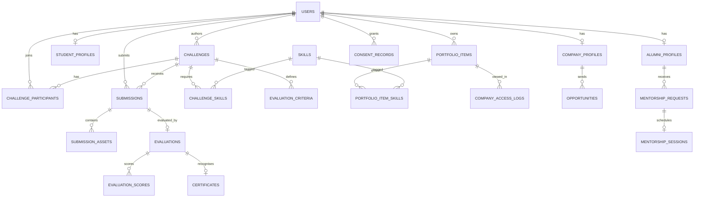

### 16.2 Core tables

**users** — identity for every role.
PK `id` (cuid). Fields: `email` (unique), `password_hash`, `name`, `role`
(STUDENT|ALUMNI|COMPANY|ADMIN), `email_verified`, `status`
(ACTIVE|SUSPENDED), `is_demo`, `created_at`, `updated_at`.
Relations: 1–1 profile by role; 1–N challenges, participations, submissions,
portfolio items, consent records. Used by **all modules**.

**student_profiles** — academic context.
PK `id`, FK `user_id` (unique). Fields: `department`, `programme`,
`graduation_year`, `bio`, `links`, `avatar_url`, `visibility`.
Used by M1, M7, M8, M10.

**alumni_profiles** — professional context.
PK `id`, FK `user_id` (unique). Fields: `graduation_year`, `department`,
`company`, `designation`, `industry`, `expertise`, `mentorship_open`,
`capacity`, `verified_at`, `verified_by`, `visibility`.
Used by M1, M2, M9, M10.

**company_profiles** — recruiter identity.
PK `id`, FK `user_id` (unique). Fields: `company_name`, `website`, `industry`,
`logo_url`, `verification_status`, `verified_by`.
Used by M8, M10.

**refresh_tokens** — session rotation.
PK `id`, FK `user_id`. Fields: `token_hash`, `expires_at`, `revoked_at`,
`user_agent`, `ip_hash`. Used by M0.

**skills** — controlled taxonomy.
PK `id`. Fields: `name` (unique), `category`. Used by M1, M2, M7.

**profile_skills** — alumni/student skill link.
PK composite (`profile_type`, `profile_id`, `skill_id`) or `id` with unique
constraint. Used by M1, M9 matching.

**challenges** — both public challenges and scoped paid tasks.
PK `id`. Fields: `slug` (unique), `title`, `summary`, `problem_statement`,
`category`, `deliverables`, `submission_format`, `duration_days`, `deadline`,
`status` (DRAFT|OPEN|CLOSED|EVALUATED|ARCHIVED), `type` (CHALLENGE|TASK),
`is_paid`, `reward_amount`, `reward_currency`, `revision_policy`, `ownership`,
`acceptance_criteria`, `author_id`, `published_at`, `is_demo`.
FK `author_id → users`. Used by M2, M3, M4, M6, M10, M11.

**challenge_skills** — many-to-many.
PK composite (`challenge_id`, `skill_id`). Used by M2, M3.

**evaluation_criteria** — published rubric.
PK `id`, FK `challenge_id`. Fields: `label`, `description`, `max_points`,
`position`. Constraint: sum per challenge = 100 (enforced in service + test).
Used by M2, M4.

**challenge_participants** — intent to compete.
PK `id`, FKs `challenge_id`, `student_id`. Fields: `status`
(APPLIED|ACTIVE|WITHDRAWN|REJECTED|COMPLETED), `applied_at`, `decided_at`.
Unique (`challenge_id`, `student_id`). Used by M3, M4, M10.

**submissions** — delivered work.
PK `id`, FKs `challenge_id`, `student_id`, `participant_id`. Fields: `title`,
`summary`, `repo_url`, `demo_url`, `status`
(DRAFT|SUBMITTED|UNDER_REVIEW|REVISION_REQUESTED|RESUBMITTED|EVALUATED|WITHDRAWN),
`submitted_at`, `is_top`, `version`.
Unique (`challenge_id`, `student_id`) for the active submission; history in
`submission_revisions` (Should). Used by M3, M4, M5, M7, M10.

**submission_assets** — private files.
PK `id`, FK `submission_id`. Fields: `storage_key`, `file_name`, `mime_type`,
`size_bytes`, `checksum`, `created_at`. Used by M3, M4.

**evaluations** — one published judgement per submission.
PK `id`, FKs `submission_id` (unique for active), `evaluator_id`,
`challenge_id`. Fields: `total_score`, `feedback`, `status`
(DRAFT|PUBLISHED|AMENDED), `published_at`, `amendment_reason`.
Used by M4, M5, M7, M10.

**evaluation_scores** — per-criterion points.
PK `id`, FKs `evaluation_id`, `criterion_id`. Fields: `points`, `comment`.
Unique (`evaluation_id`, `criterion_id`). Used by M4, M5.

**certificates** — appreciation records.
PK `id`, FK `evaluation_id` (unique), `student_id`, `issuer_id`.
Fields: `public_id` (unique, URL-safe), `challenge_title`, `student_display`,
`recognised_skills`, `score`, `issued_at`, `revoked_at`, `revoke_reason`,
`payload_hash` (SHA-256), `pdf_storage_key`, `consent_public`.
Used by M5, M7, M10, M11.

**portfolio_items** — student-curated evidence.
PK `id`, FK `student_id`, optional `submission_id`, `certificate_id`.
Fields: `title`, `summary`, `links`, `visibility`
(PRIVATE|COMPANY|PUBLIC), `is_demo`, `created_at`. Used by M7, M8, M11.

**portfolio_item_skills** — tags.
PK composite (`item_id`, `skill_id`). Used by M7, M8.

**consent_records** — auditable permissions.
PK `id`, FK `student_id`. Fields: `scope`
(PORTFOLIO_COMPANY|PORTFOLIO_PUBLIC|SHOW_NAME|ALLOW_INVITES|WALL_OF_RECOGNITION),
`granted`, `granted_at`, `revoked_at`, `policy_version`.
Used by M7, M8, M11.

**company_access_logs** — who viewed what.
PK `id`, FKs `company_id`, `student_id`, `portfolio_item_id`. Fields:
`action` (VIEW|SEARCH_HIT|INVITE), `created_at`, `ip_hash`. Used by M8, M10.

**opportunities** — invitations.
PK `id`, FKs `company_id`, `student_id`, optional `portfolio_item_id`.
Fields: `type` (INTERVIEW|INTERNSHIP|ASSESSMENT), `message`, `status`
(SENT|ACCEPTED|DECLINED|WITHDRAWN), `created_at`, `responded_at`.
Used by M8.

**mentorship_requests / mentorship_sessions** — guidance lifecycle.
PKs `id`; FKs `student_id`, `alumni_id`. Fields: `topic`, `message`, `status`,
`preferred_at`, `scheduled_at`, `duration_minutes`, `notes`, `outcome`.
Used by M9, M10.

**knowledge_resources** — approved material.
PK `id`, FK `author_id`. Fields: `title`, `summary`, `type`, `url_or_key`,
`status` (DRAFT|APPROVED|ARCHIVED), `approved_by`, `published_at`.
Used by M9.

**tasks / task_assignments** — delegation. **Decision:** use `challenges` with
`type = TASK` rather than a duplicate table; `task_assignments` stores the
selected student, agreed terms snapshot, completion and reward status.
PK `id`, FKs `challenge_id`, `student_id`. Used by M6, M10.

**notifications** — in-app events.
PK `id`, FK `user_id`. Fields: `type`, `payload`, `read_at`, `created_at`.
Used by all modules.

**audit_logs** — accountability.
PK `id`, FK `actor_id`. Fields: `action`, `target_type`, `target_id`,
`metadata` (redacted), `ip_hash`, `created_at`. Used by M10 and every privileged
mutation.

**events** — career talks and showcases (Should).
PK `id`. Fields: `title`, `category`, `starts_at`, `location_type`, `summary`,
`published`. Used by M9 and the landing events section.

### 16.3 Tables deliberately not created

| Not created | Reason |
|---|---|
| `rankings` table | Rank is derived from evaluation totals per challenge; storing it duplicates truth. |
| `admins` table | Admins are `users` with role ADMIN; a second identity table would fragment auth. |
| `certificate_verifications` (initially) | Verification is a read; logging optional views is not MVP. |
| `payments` | No money movement in the MVP. `reward_records` covers agreed terms. |
| Separate `student_skills` and `alumni_skills` | `profile_skills` with a profile type avoids duplication. |

### 16.4 Indexing plan **[PROP]**

- `challenges(status, published_at)`, `challenges(slug)` unique.
- `challenge_participants(challenge_id, status)`, unique `(challenge_id, student_id)`.
- `submissions(challenge_id, status)`, `submissions(student_id, created_at)`.
- `evaluations(challenge_id, status)`.
- `certificates(public_id)` unique, `certificates(student_id)`.
- `portfolio_items(student_id, visibility)`.
- `consent_records(student_id, scope)`.
- `company_access_logs(company_id, created_at)`, `(student_id, created_at)`.
- `notifications(user_id, read_at)`.
- `audit_logs(created_at)`, `(actor_id)`.

---

## 17. Module Dependencies and Data Flow

### 17.1 Dependency legend

| Code | Meaning |
|---|---|
| **D** | Direct dependency — the module cannot function without it. |
| **S** | Data-sharing dependency — reads records produced elsewhere but can render without owning them. |
| **O** | Optional integration — improves the experience, safe to omit. |
| **F** | Future enhancement only. |
| **—** | No dependency. |

### 17.2 Dependency matrix (row depends on column)

| | M0 Auth | M1 Alumni | M2 Challenges | M3 Submit | M4 Eval | M5 Cert | M6 Tasks | M7 Portfolio | M8 Company | M9 Mentor | M10 Admin | M11 3D |
|---|---|---|---|---|---|---|---|---|---|---|---|---|
| **M1 Alumni hub** | D | — | — | — | — | — | — | — | — | — | — | — |
| **M2 Challenge hub** | D | D | — | — | — | — | — | — | — | — | — | — |
| **M3 Participation** | D | S | D | — | — | — | — | — | — | — | — | — |
| **M4 Evaluation** | D | S | D | D | — | — | — | — | — | — | — | — |
| **M5 Certificates** | D | D | S | S | D | — | — | — | — | — | — | — |
| **M6 Task delegation** | D | D | D | S | O | O | — | — | — | — | — | — |
| **M7 Portfolio** | D | S | S | D | S | S | S | — | — | — | — | — |
| **M8 Company discovery** | D | S | — | — | — | O | — | D | — | — | — | — |
| **M9 Mentorship** | D | D | — | — | — | — | — | O | — | — | — | — |
| **M10 University dashboard** | D | S | S | S | S | S | S | S | S | S | — | — |
| **M11 3D hub** | D | F | D | O | — | F | — | D | — | F | — | — |

### 17.3 The seven chains that matter

**Chain 1 — Identity is the root.**
`users` → profile → everything. Remove authentication and no other module can
attribute a challenge, a submission or a certificate. This is why Phase 5 is
sequenced before all domain work.

**Chain 2 — Author → challenge.**
`alumni_profiles` supplies the author, industry context and contact visibility.
A challenge without a verified author cannot be published; the UI and the API both
read the profile when rendering the challenge.

**Chain 3 — Challenge → participation → submission.**
A challenge owns its skills, rubric and participants. A submission requires a
participation row and a challenge that is still open (or an explicit extension).
This prevents orphan work and makes "who took part" answerable.

**Chain 4 — Submission → evaluation → ranking.**
The rubric comes from the challenge, the scores come from the evaluator, and the
rank is computed inside one transaction per challenge. Publishing freezes scores
and emits notifications.

**Chain 5 — Evaluation → certificate → verification.**
A certificate stores a reference to the evaluation, so the QR page can always show
which challenge and which issuer produced it. The SHA-256 hash covers the canonical
payload; changing a name, skill or score invalidates verification.

**Chain 6 — Certificate + submission → portfolio → consent → company.**
Portfolio items are references, not copies. Consent is queried at read time, which
is what makes revocation immediate. Company access logs prove what was viewed and
by whom.

**Chain 7 — Everything → analytics → university.**
The dashboard is a read model: it never stores counters of its own. If a challenge
is archived or a certificate revoked, the dashboard reflects it on the next query.

### 17.4 Dependency graph

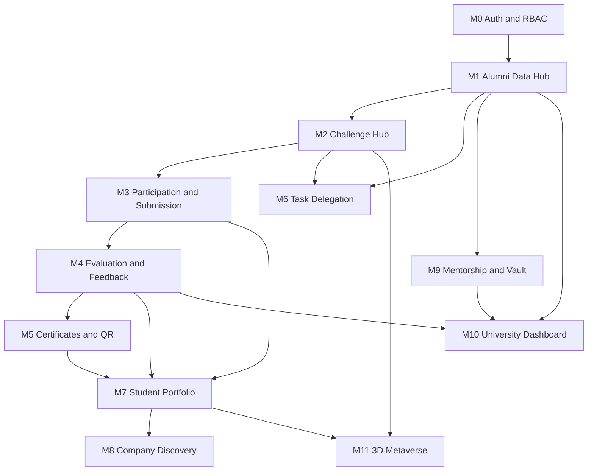

### 17.5 How the 3D hub stays integrated

- It calls `GET /api/challenges` and a consented portfolio endpoint; it never
  ships its own JSON fixtures. **[SRC]**
- It shares the session; entering the campus does not create a second login.
- Every interactive object resolves to a real route.
- If an API is down, the room shows a retry state, not fabricated content.

### 17.6 Optional and future integrations

| Integration | Type | Effect if omitted |
|---|---|---|
| M5 → M6 (certificate for a paid task) | Optional | Task completion still recorded; recognition unavailable. |
| M7 → M9 (mentorship outcome on portfolio) | Optional | Portfolio still valid. |
| M11 → M1/M5/M9 (Career Hall, Wall, Mentorship Room) | Future | Lobby remains complete with two active rooms. |
| M10 → M8 (company engagement metrics) | Future | University reporting omits company activity. |

---

## 18. Fifteen-Phase Development Roadmap

### 18.1 Overview

| Phase | Name | Primary modules | Key output | Depends on |
|---|---|---|---|---|
| 1 | Requirement analysis and planning | — | This document | — |
| 2 | UI/UX design and journeys | — | Wireframes, tokens, journey maps | 1 |
| 3 | Setup and environment | — | Running monorepo, CI skeleton | 1, 2 |
| 4 | Database and backend foundation | M0 (data) | Schema, migrations, seed, health | 3 |
| 5 | Auth, roles, permissions | M0 | Register/login/RBAC/sessions | 4 |
| 6 | Alumni hub and profiles | M1 | Directory, profiles, verification | 5 |
| 7 | Challenge hub and task delegation | M2, M6 | Create/publish/browse, paid terms | 6 |
| 8 | Participation and submission | M3 | Apply, upload, track | 7 |
| 9 | Evaluation, ranking, feedback | M4 | Rubric scoring, ranks, results | 8 |
| 10 | Certificates and verification | M5 | PDF, QR, hash, revoke | 9 |
| 11 | Portfolio and company discovery | M7, M8 | Consent portfolio, search, invites | 9 |
| 12 | Mentorship and Knowledge Vault | M9 | Requests, sessions, resources | 6 |
| 13 | University dashboard | M10 | Analytics, exports, moderation | 9, 11 |
| 14 | 3D Metaverse hub | M11 | Lobby, Arena, Lab, fallback | 8, 11 |
| 15 | Integration, testing, security, deployment | all | Hardened release | 10–14 |

### 18.2 Phase detail

#### Phase 1 — Requirement Analysis and System Planning
- **Objective:** establish a single, testable baseline for all later work.
- **Modules:** all (definitions only).
- **Tasks:** analyse the source PDF; reconcile it with the landing brief; define
  roles, permissions, workflows, requirements, data rules, architecture and
  roadmap; agree MVP scope.
- **Technologies:** documentation only (Markdown, Mermaid).
- **Inputs:** `AlumniConnect_Complete_Project_Plan.pdf`, landing-page brief, confirmed decisions.
- **Dependencies:** none.
- **Outputs:** this document, glossary, acceptance checklist.
- **Interactions:** every later phase cites requirement IDs from here.
- **Testing:** traceability review — every MVP feature maps to an FR and a phase.
- **Completion:** checklist in §20 is fully ticked.

#### Phase 2 — UI/UX Design and User Journey Planning
- **Objective:** turn requirements into screens a team can build without guessing.
- **Modules:** all UI surfaces.
- **Tasks:** journey maps for the five journeys in §6.3; wireframes for auth,
  dashboards, challenge create/detail, submission, review, certificate, portfolio,
  company search, admin; design tokens already in the landing page; empty/error
  state designs; 3D lobby map.
- **Technologies:** Figma, existing Tailwind tokens.
- **Inputs:** this document, brand palette, landing page as visual reference.
- **Dependencies:** Phase 1.
- **Outputs:** Figma file, component inventory, screen-to-FR matrix.
- **Interactions:** feeds Phases 5–14; prevents ad-hoc UI in each phase.
- **Testing:** heuristic review; contrast and focus specifications; usability walkthrough of the demo script.
- **Completion:** every FR that needs a screen has a wireframe and a state definition.

#### Phase 3 — Project Setup and Development Environment
- **Objective:** one command starts web, API and database tooling.
- **Modules:** infrastructure.
- **Tasks:** npm workspaces; Vite + React + TS + Tailwind; Express + tsx;
  Prisma; env templates; lint/typecheck scripts; seed command; `/api/health`;
  Vite proxy; README; `.gitignore`; error/404 middleware.
- **Technologies:** Node 20+, npm, Vite, Express, Prisma, TypeScript.
- **Inputs:** Phase 2 component decisions.
- **Dependencies:** Phases 1–2.
- **Outputs:** running local stack (`web:5173`, `api:4000`), committed scripts.
- **Interactions:** every later phase adds routes to this shell.
- **Testing:** `npm run typecheck`, `npm run build`, health check, cold start.
- **Completion:** a new developer can clone and run the app from the README alone.
- **Status:** largely complete in the current repository.

#### Phase 4 — Database Design and Backend Foundation
- **Objective:** make the data model real and safe to extend.
- **Modules:** M0 data layer, shared services.
- **Tasks:** implement the §16 tables that MVP needs; migrations; seed with
  labelled demo users (1 alumni, 6 students), challenges and submissions; shared
  Prisma client; DTO conventions; pagination helpers; error codes; audit-log
  middleware scaffold.
- **Technologies:** Prisma, SQLite locally / PostgreSQL target.
- **Inputs:** §16, Phase 3 shell.
- **Dependencies:** Phase 3.
- **Outputs:** migration(s), seed, repository/service skeleton.
- **Interactions:** unblocks every domain phase.
- **Testing:** migrate from empty DB; seed idempotency; constraint tests (unique
  participation, rubric total).
- **Completion:** schema covers M1–M5 core rows and `prisma migrate reset` succeeds.
- **Status:** partial — 6 models exist (User, AlumniProfile, Skill, Challenge,
  ChallengeSkill, Submission); remaining tables are planned.

#### Phase 5 — Authentication, Roles and Permissions
- **Objective:** one identity that every module trusts.
- **Modules:** M0.
- **Tasks:** register, login, refresh rotation, logout, email verification,
  password reset, suspension, session list/revoke, `requireRole`/`requireOwner`,
  rate limiting, `/api/me`.
- **Technologies:** bcrypt, JWT, Zod, Express middleware, Nodemailer (console in dev).
- **Inputs:** Phase 4 `users`, `refresh_tokens`.
- **Dependencies:** Phase 4.
- **Outputs:** auth endpoints, guards, login/register/verify pages, role-aware nav.
- **Interactions:** gates every protected route in Phases 6–14.
- **Testing:** role matrix negative tests, token reuse detection, rate-limit test,
  suspended-user test.
- **Completion:** all four roles can sign in; unauthorised calls return 401/403;
  refresh rotation verified.

#### Phase 6 — Centralized Alumni Data Hub and Profiles
- **Objective:** replace fragmented records with one searchable source.
- **Modules:** M1.
- **Tasks:** alumni/student/company profile forms; skills taxonomy; directory with
  search and filters; field visibility; admin verification; CSV import (Should);
  profile completeness prompts.
- **Technologies:** React forms, Zod, Prisma, Postgres full-text or `ILIKE` search.
- **Inputs:** Phase 5 identity; phase 2 wireframes.
- **Dependencies:** Phase 5.
- **Outputs:** `/alumni`, `/alumni/:id`, profile APIs, verification UI.
- **Interactions:** supplies authors to M2, mentors to M9, records to M10, booths to M11.
- **Testing:** visibility tests (hidden fields absent from payloads), filter
  combinations, verification audit entry.
- **Completion:** a student can find an alumnus by skill and open a profile that
  respects the alumnus's visibility settings.

#### Phase 7 — Alumni Challenge Hub and Task Delegation
- **Objective:** let alumni publish scoped, evaluable work.
- **Modules:** M2, M6.
- **Tasks:** draft/publish; rubric editor with 100-point validation; skills,
  deliverables, deadline; paid/unpaid terms; clarification Q&A; close/archive;
  deadline scheduler; task assignment flow with terms snapshot.
- **Technologies:** React forms, Zod, Prisma transactions, cron/interval job.
- **Inputs:** Phase 6 author profile.
- **Dependencies:** Phase 6.
- **Outputs:** `/hub`, `/hub/:slug`, author dashboard, challenge APIs.
- **Interactions:** feeds M3 (participation), M10 (counts), M11 (Arena).
- **Testing:** rubric total enforcement; paid-without-terms rejection; deadline
  auto-close; edit lock after first submission.
- **Completion:** an alumni can publish a valid challenge that appears in the hub
  and in the API, and a paid task cannot be published without full terms.

#### Phase 8 — Student Participation and Project Submission
- **Objective:** convert interest into delivered, private work.
- **Modules:** M3.
- **Tasks:** apply/withdraw; submission drafts; file upload to private storage;
  repository/demo links; status timeline; revision requests entry point; deadline
  enforcement; asset authorisation.
- **Technologies:** multer/busboy, storage adapter, signed URLs, Zod.
- **Inputs:** Phase 7 challenges, Phase 5 sessions.
- **Dependencies:** Phase 7.
- **Outputs:** participation and submission APIs, student submission pages,
  alumni review queue (empty until Phase 9).
- **Interactions:** feeds M4, M7, M10, M11.
- **Testing:** upload type/size rejection, cross-user asset access 403, duplicate
  application 409, late submission 409.
- **Completion:** a student applies, submits files and links, and only the student,
  author and admin can download the assets.
- **Backend note:** the scaffold already contains `Submission` with score and
  feedback columns; Phase 9 extracts evaluation into its own table.

#### Phase 9 — Alumni Evaluation, Ranking and Feedback
- **Objective:** produce transparent, challenge-scoped judgement.
- **Modules:** M4.
- **Tasks:** review queue; rubric scoring UI; draft/publish; feedback; revision
  request; ranking transaction; top submission uniqueness; student result view;
  amendment history; dispute note.
- **Technologies:** Prisma transactions, Zod, notification dispatcher.
- **Inputs:** Phase 7 rubric, Phase 8 submissions.
- **Dependencies:** Phase 8.
- **Outputs:** evaluation APIs, review page, result pages, notifications.
- **Interactions:** gates M5; feeds M7 and M10.
- **Testing:** non-owner 403; score range validation; rank determinism; second top
  flag moves designation; publish freezes scores.
- **Completion:** the seeded Customer Complaint Analyzer scenario produces
  92/84/76 with one top submission and visible feedback.

---

#### Phase 10 — Appreciation Certificates and QR Verification
- **Objective:** issue recognition that can be checked independently.
- **Modules:** M5.
- **Tasks:** certificate record; canonical payload; SHA-256; PDF template with
  mandatory disclosure; QR encoding the public URL; verify page; revoke with
  reason; owner-scoped download; certificate list.
- **Technologies:** pdf-lib/PDFKit, `qrcode`, Node crypto, private storage.
- **Inputs:** Phase 9 published evaluation.
- **Dependencies:** Phase 9.
- **Outputs:** `/verify/:publicId`, certificate APIs, PDF artefacts.
- **Interactions:** feeds M7 portfolio, M10 analytics, M11 Wall (future).
- **Testing:** hash tamper test; revoked certificate resolution; PDF opens and
  contains the disclosure; unknown ID returns a clean 404 page.
- **Completion:** a certificate issued in the demo verifies in a private window
  and states clearly that it is alumni appreciation, not a university credential.

#### Phase 11 — Student Portfolio and Company Discovery
- **Objective:** turn evaluated work into consented, discoverable evidence.
- **Modules:** M7, M8.
- **Tasks:** portfolio item CRUD from evaluated work or manual entry; per-item
  visibility; consent records; public/company preview; recruiter search;
  limited DTO; access logs; invitations; student responses; company pipeline.
- **Technologies:** React, Prisma, consent guard middleware, pagination.
- **Inputs:** Phase 9 evaluations, Phase 10 certificates, Phase 6 company profiles.
- **Dependencies:** Phase 9 (portfolio), Phase 10 (certificate display).
- **Outputs:** `/p/:handle`, portfolio dashboard, `/company/search`, pipeline.
- **Interactions:** feeds M10 aggregate metrics and M11 Innovation Lab.
- **Testing:** consent-off payloads; revocation immediacy; cross-company isolation;
  invitation blocked without consent.
- **Completion:** a company can find only consented items, open one, and send an
  invitation that the student can accept or decline.

#### Phase 12 — Mentorship and Knowledge Vault
- **Objective:** structure guidance and preserve approved knowledge.
- **Modules:** M9.
- **Tasks:** mentor availability; request/accept/decline/reschedule; session
  records and notes; resource upload and approval; vault search; career talk events.
- **Technologies:** React, Prisma, search, optional file storage.
- **Inputs:** Phase 6 alumni expertise.
- **Dependencies:** Phase 6 (can run in parallel with Phases 7–11).
- **Outputs:** `/mentorship`, `/vault`, mentor APIs.
- **Interactions:** feeds M10 mentorship metrics; future M11 Mentorship Room.
- **Testing:** duplicate request prevention, state transitions, approval visibility.
- **Completion:** a student requests a session, an alumnus schedules it, and both
  see the same session record; unapproved resources never appear in search.

#### Phase 13 — University Engagement Dashboard
- **Objective:** give administrators a truthful, exportable view.
- **Modules:** M10.
- **Tasks:** aggregate queries; date/department filters; alumni, challenge,
  participation, mentorship and certificate widgets; moderation queue; role
  management; audit viewer; CSV/PDF export with demo labelling.
- **Technologies:** SQL aggregates via Prisma, chart components, export service.
- **Inputs:** data produced by Phases 6–12.
- **Dependencies:** Phases 6–12 (can begin once Phases 6 and 9 exist).
- **Outputs:** `/admin` dashboards, export files, audit UI.
- **Interactions:** read-only over all modules; no write-back.
- **Testing:** metric correctness against seeded fixtures; filter consistency;
  export content; admin-only access.
- **Completion:** every dashboard number can be reproduced with a direct query and
  the exported report states its window and demo status.

#### Phase 14 — 3D Metaverse Alumni Hub Development and Integration
- **Objective:** deliver a compact, genuinely connected virtual campus.
- **Modules:** M11.
- **Tasks:** R3F scene; lobby; Challenge Arena; Innovation Lab; clickable objects;
  keyboard/touch navigation; deep links; lazy loading; quality tiers; 2D fallback;
  future-room labelling.
- **Technologies:** React Three Fiber, Drei, dynamic import, existing APIs.
- **Inputs:** Phase 7 challenges, Phase 11 consented portfolio items, Phase 5 session.
- **Dependencies:** Phases 7 and 11 for live data; scene scaffold can start after Phase 5.
- **Outputs:** `/campus`, fallback directory, asset budget document.
- **Interactions:** all clicks return to 2D routes; no separate data.
- **Testing:** challenge appears without reseed; private items never render;
  WebGL-disabled fallback; keyboard traversal; frame budget on integrated GPU.
- **Completion:** the Arena shows a challenge created in 2D, the Lab hides private
  projects, and every space is reachable without WebGL.

#### Phase 15 — Complete System Integration, Testing, Security and Deployment
- **Objective:** ship a coherent, defensible MVP.
- **Modules:** all.
- **Tasks:** end-to-end chain test; RBAC matrix; rate limits; headers; upload
  hardening; audit coverage; accessibility pass; performance budgets; seed guard;
  Postgres cutover; production env; backups; runbook; demo rehearsal.
- **Technologies:** Vitest/Supertest, Playwright, Lighthouse/axe, Docker or managed
  hosting, PostgreSQL, object storage.
- **Inputs:** all previous phases.
- **Dependencies:** Phases 10–14.
- **Outputs:** deployed app, test suite, security checklist, demo script, README.
- **Interactions:** locks the release; no new features after freeze.
- **Testing:** full regression, negative security tests, six-width responsive audit,
  reduced-motion audit, certificate verification from a clean device.
- **Completion:** the demo script runs twice consecutively without manual data fixes;
  zero known critical security issues; documented rollback path.

### 18.3 Parallel work tracks

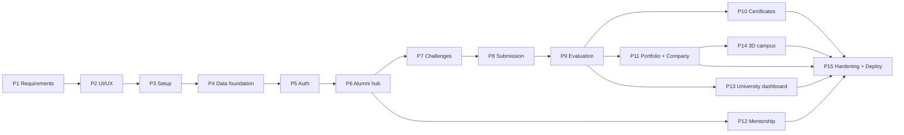

| Track | Phases | Can run in parallel with | Rule |
|---|---|---|---|
| Core collaboration | 5 → 6 → 7 → 8 → 9 → 10 | nothing (it is the critical path) | Protect this chain first. |
| Portfolio + company | 11 | 10, 12 | Needs published evaluations only. |
| Mentorship | 12 | 7–11 | Needs alumni profiles only. |
| Analytics | 13 | 10–12 | Needs Phase 9 data; can start read-only earlier. |
| 3D campus | 14 | 10–13 | Scaffold after 5; live data after 8 and 11. |
| Quality | 15 | continuous from 5 | Smoke tests added with each phase, finalised at the end. |

**Team allocation suggestion (4–5 people):** one owner for API/DB, one for the
core challenge flow UI, one for certificates/portfolio/company, one for 3D and
visual polish, one rotating QA/docs role. The critical path stays with the API and
challenge-flow owners.

---

## 19. Acceptance Criteria for Phase 1

The phase is complete when each item below is satisfied **in this document**, not
when code exists.

| # | Criterion | Where it is satisfied | Status |
|---|---|---|---|
| 1 | Project identity and objective finalised | §1, §2 | Met |
| 2 | Problem statement and proposed solution documented | §4 | Met |
| 3 | Four user roles identified | §5.1 | Met |
| 4 | Responsibilities and permissions defined | §5.2, §5.3 | Met |
| 5 | Main modules identified | §9 (M1–M11) | Met |
| 6 | Functional requirements defined | §7 (FR-01…FR-120) | Met |
| 7 | Non-functional requirements defined | §8 (NFR-01…NFR-30) | Met |
| 8 | Complete platform workflow documented | §6 | Met |
| 9 | MVP and future scope finalised | §10, §11 | Met |
| 10 | 3D Metaverse requirements documented | §12 | Met |
| 11 | Technical architecture proposed | §14, §15 | Met |
| 12 | Database tables and relationships identified | §16 | Met |
| 13 | Module dependencies and data flow documented | §17 | Met |
| 14 | 15-phase roadmap prepared | §18 | Met |
| 15 | Testable completion criteria established | §7 acceptance column, §18, §19 | Met |

---

## 20. Phase 1 Completion Checklist

Use this as the sign-off page before Phase 2 starts.

- [x] Source PDF analysed and cited (8 modules, 5 spaces, demo scenario, rubric, paid-task terms).
- [x] Landing brief reconciled with the source (visual direction only; no product replacement).
- [x] Project name, title, tagline and one-line pitch fixed.
- [x] Four roles defined with a capability matrix.
- [x] Student consent model documented with five scopes.
- [x] Six problems mapped to root cause, impact, solution and module.
- [x] Primary 17-step workflow documented with the record written at each step.
- [x] Five alternate journeys documented (mentorship, paid/unpaid, company, admin, 3D).
- [x] State machines defined for challenge, participation, submission, certificate and mentorship.
- [x] 120 functional requirements with role, priority, dependency, acceptance and scope.
- [x] 30 non-functional requirements with implementation impact and verification.
- [x] 11 delivery modules mapped to the 8 source modules.
- [x] MVP Must/Should/Could/Won't split agreed.
- [x] Demo narrative and definition of done written.
- [x] Future scope table with prerequisites.
- [x] 3D spaces mapped to data sources with MVP/fallback/acceptance criteria.
- [x] Twelve privacy and trust rules mapped to enforcement mechanisms.
- [x] Stack decisions recorded, including SQLite-dev → PostgreSQL-target plan.
- [x] Three-layer architecture, middleware order and API surface documented.
- [x] Database design with PK/FK, relationships, ownership and indexes.
- [x] Tables deliberately not created, with reasons.
- [x] Dependency matrix, seven data chains and dependency graph.
- [x] 15 phases with objective, tasks, tech, inputs, dependencies, outputs, testing and completion.
- [x] Parallel tracks and team allocation guidance.
- [x] Acceptance criteria and this checklist.
- [ ] Team review meeting held (to be ticked by the team).
- [ ] Phase 2 kickoff approved (to be ticked by the team).

**Phase 1 is documentation-complete. Phase 2 must not begin until the two open
boxes above are ticked.**

---

## Appendix A — Glossary

| Term | Meaning in this project |
|---|---|
| Appreciation certificate | An alumni-issued recognition record with ID, QR and hash. **Not** an academic credential. **[SRC]** |
| Challenge | A scoped real-world problem published by an alumnus with skills, deliverables, deadline and rubric. **[SRC]** |
| Challenge-scoped ranking | Position within one challenge only; never a global student ranking. **[SRC]** |
| Task delegation | Scoped paid or unpaid work assigned to a selected student, with agreed terms. **[SRC]** |
| Knowledge Vault | Searchable repository of alumni-approved lectures, case studies and insights. **[SRC]** |
| AI Alumni Twin | Future AI assistant grounded in approved content; must disclose that it is AI. **[SRC]** |
| Metaverse Alumni Hub | Browser-based 3D campus; no VR hardware required. **[SRC]** |
| Challenge Arena | 3D space listing open challenges; opens the real challenge page. **[SRC]** |
| Innovation Lab | 3D space displaying consented student projects. **[SRC]** |
| Career Hall | Future 3D space for alumni/industry booths. **[SRC]** |
| Mentorship Room | Future 3D space for scheduled sessions. **[SRC]** |
| Wall of Recognition | Future 3D space for consented appreciation records. **[SRC]** |
| Consent record | An auditable, revocable permission granted by a student. **[PROP]** |
| Demo data | Seeded content explicitly labelled as demonstration, never presented as real outcomes. **[SRC]** |
| MVP | The smallest build that proves the full challenge-to-portfolio chain plus a compact 3D campus. **[SRC]** |

## Appendix B — Source traceability

| Source PDF section | Where it is used here |
|---|---|
| 1. Executive summary / one-line pitch | §1, §2 |
| 2. Problem statement | §4 (expanded with root cause and impact) |
| 3. Proposed solution | §1, §6, §9 |
| 4. 3D Metaverse feature and spaces | §12, M11 |
| 5. Users and roles | §5 |
| 6. Core feature modules (8) | §9 (mapped to 11 delivery modules) |
| 7. Complete example (Rahul / Aditi / 92-84-76) | §10.3, §18 Phase 9 |
| 8. Paid task example (₹3,000) | §6.3B, §13 rules 8–10, M6 |
| 9. End-to-end workflow (10 stages) | §6.1 (expanded to 17 steps) |
| 10. Technical architecture | §14, §15 |
| 11. Hackathon MVP and priorities (7 must-haves) | §10.1, §10.2 |
| 12. Feasibility, privacy and trust risks | §8, §13, Appendix D |
| 13. Expected impact | §2.2 |
| 14. SIH PPT structure | §10.3 (demo narrative) |
| 15. Demo script | §10.3 |
| 16. Final explanation | §1 |
| 17. Product principles | §1.3, §13, §19 |

**Reconciliations made explicitly:**

1. The PDF lists **8 modules**; this plan delivers **11** by splitting submission
   from evaluation, portfolio from company discovery, and paid task delegation
   from the public challenge hub. No source capability was dropped. **[PROP]**
2. The PDF allows Unity WebGL or Three.js; the confirmed decision is **React Three
   Fiber / Three.js** inside the existing React app. **[DEC]**
3. The PDF proposes a full 5-space campus; the MVP builds **lobby + Arena + Lab**
   and labels the rest as future. **[DEC]**
4. The brief names Module 6 "Task Delegation and Rewards"; this plan implements it
   on the shared `challenges` table with `type = TASK` to avoid duplicate structures.
   **[PROP]**
5. The brief's 17-step workflow expands the PDF's 10-stage table; both describe the
   same chain.

## Appendix C — Current implementation status

Honest mapping between the repository today and this roadmap.

| Area | State | Notes |
|---|---|---|
| Landing page (Phase 1 code) | Complete | 17 sections, design tokens, GSAP motion layer, responsive audit passed. |
| API scaffold | Complete | `/api/health`, `/api/challenges`, `/api/stats`; CORS; error handling. |
| Database | Partial | 6 models: User, AlumniProfile, Skill, Challenge, ChallengeSkill, Submission. SQLite via Prisma. |
| Seed | Complete for demo | 7 users, 3 challenges, 55 submissions, labelled demo data. |
| Auth / RBAC | Not built | Roadmap Phase 5. |
| Profiles beyond alumni basics | Not built | Roadmap Phase 6. |
| Participation / submission forms | Not built | Roadmap Phase 8 (model exists). |
| Evaluation model | Partial | Score/feedback columns on `Submission`; to be extracted into `evaluations` + `evaluation_scores` in Phase 9. |
| Certificates | Not built | Roadmap Phase 10. |
| Portfolio / company | Not built | Roadmap Phase 11. |
| Mentorship / vault | Not built | Roadmap Phase 12. |
| Admin dashboard | Not built | Roadmap Phase 13. |
| 3D campus | Not built | Landing page contains an isometric preview only. |
| Tests | Not built | Typecheck and build are the current gates. |

**Roadmap numbering vs code phases:** the landing page was delivered as "code
Phase 1" and the API scaffold as "code Phase 2". In this roadmap they correspond to
outputs of Phases 2–4. The roadmap numbering in §18 is the numbering used from now
on; old labels should not be reused to avoid ambiguity.

## Appendix D — Risk analysis

**Scale:** Likelihood (L) and Impact (I) are rated L / M / H (1 / 2 / 3); Score =
L × I. Scores of 6–9 require a mitigation owner and a written contingency before
the related phase starts; 3–5 require monitoring; 1–2 are accepted.

| ID | Risk | Category | L | I | Score | Early trigger | Mitigation | Contingency | Owner | Phase |
|---|---|---|---|---|---|---|---|---|---|---|
| R-01 | Scope creep (payments, AI, blockchain, full campus) | Delivery | H | H | 9 | Any request outside §10 during a build phase | §10 gate: new ideas go to §11 backlog, not the sprint | Drop optional module, protect the core chain | Lead | ongoing |
| R-02 | Critical-path delay in API or challenge flow | Delivery | H | H | 9 | Phase 8 slips more than 3 days | Pair on API; daily end-to-end smoke run | Drop Should features (Q&A, drafts, CSV import) | Lead | 5–9 |
| R-03 | Email provider not chosen | Dependency | M | H | 6 | No verification mail on staging | Console transport now; decide before Phase 5 exits | Manual verification during demo | Backend | 5 |
| R-04 | PostgreSQL cutover failures | Technical | M | H | 6 | Migration or query behaves differently | CI migrates both providers from Phase 4 | Postpone cutover; demo on SQLite, document gap | Data | 15 |
| R-05 | Consent leak to companies | Privacy | L | H | 3 | Non-consented item appears in a recruiter payload | Consent guard + DTO allowlist + CI negative test | Disable company module for the demo | Backend | 11 |
| R-06 | Demo data mistaken for real outcomes | Trust | M | H | 6 | Screenshot or slide without a demo label | `isDemo` flags, visible badges, export banner | Verbal disclaimer in the demo script | Design/QA | all |
| R-07 | Certificate wording or branding rejected late | Compliance | M | M | 4 | College requests template changes in Phase 15 | Freeze disclosure copy in Phase 10; early review | Ship a neutral template without institutional marks | Design | 10 |
| R-08 | 3D performance on lab hardware | Technical | M | M | 4 | Frame rate below 30 fps or load over 4 s | Quality tiers, lazy loading, asset budget | Auto-fallback to the 2D campus | 3D owner | 14 |
| R-09 | Team bandwidth drops (exams, illness) | Delivery | M | H | 6 | Velocity falls for two consecutive weeks | Parallel tracks in §18.3; buffer week before Phase 15 | Cut Could items; freeze features | Lead | all |
| R-10 | Single evaluator causes delay or bias | Product | M | M | 4 | Reviews pending more than 7 days or a dispute | Publish rubric, allow dispute notes | Multi-reviewer panel later | Product | 9 |
| R-11 | PII exposed on the public verify page | Privacy | L | H | 3 | Contact field visible without login | Fixed field allowlist; copy test | Hotfix, purge cache, notify affected students | Backend | 10 |
| R-12 | Storage provider undecided | Dependency | M | M | 4 | Uploads work only on one machine | Storage interface + local adapter | Demo on local storage with seeded files | Backend | 8 |
| R-13 | Last admin demoted or locked out | Operational | L | M | 2 | Only one ADMIN row exists | Guard on role update; seed a second admin | Recovery script with audit entry | Backend | 13 |
| R-14 | Deadline/timezone disputes | Product | M | M | 4 | Student claims an on-time submission | Server UTC is authoritative; display local TZ | Author grants an explicit extension | Backend | 8 |
| R-15 | Abusive free-text feedback | Moderation | M | L | 2 | Report received | Length limits, report action, admin queue | Remove content and notify parties | Admin | 9 |
| R-16 | Browser without WebGL | Compatibility | M | M | 4 | Campus fails to initialise | Feature detection + 2D fallback | Link directly to the 2D hub | 3D owner | 14 |
| R-17 | Certificate PDF generation failure | Reliability | L | M | 2 | PDF endpoint returns 5xx | Transaction + retry + outbox | Re-issue from the stored record | Backend | 10 |

**Open decisions** (must be closed by the phase listed):

| Decision | Why it is open | Needed by |
|---|---|---|
| Email provider | Not needed for local development | Phase 5 |
| Storage provider (Cloudinary vs S3-compatible) | Interface can hide the choice | Phase 8 |
| Certificate visual template | Needs college/brand approval | Phase 10 |
| Hosting target | Depends on team accounts and budget | Phase 15 |
| `university_id` column | Multi-university is future; adding it late is costly | Phase 4 |

---

## Appendix E — Phase 1 deliverable index

Mapping of the agreed Phase 1 work items to the sections that satisfy them.

| # | Phase 1 task | Where it is delivered | Status |
|---|---|---|---|
| 1 | Project requirement analysis | §1–§4, §10–§11, Appendix B | Complete |
| 2 | Functional requirements | §7 (FR-01 … FR-120) | Complete |
| 3 | Non-functional requirements | §8 (NFR-01 … NFR-30) | Complete |
| 4 | User roles and permissions | §5 (roles, capability matrix, consent scopes) | Complete |
| 5 | Complete system workflows | §6 (17-step flow, 5 alternate journeys, state machines) | Complete |
| 6 | Module identification | §9 (M1–M11, mapped to the 8 source modules) | Complete |
| 7 | Module dependencies | §17 (matrix, seven data chains, dependency graph) | Complete |
| 8 | System architecture | §14 (stack), §15 (layers, request lifecycle, repo layout) | Complete |
| 9 | Database planning | §16 (tables, keys, relationships, indexes, exclusions) | Complete |
| 10 | API requirements | §15.4 (surface), §15.7 (contract, errors, limits, uploads) | Complete |
| 11 | Risk analysis | Appendix D (17 scored risks + open decisions) | Complete |
| 12 | Development roadmap | §18 (15 phases, parallel tracks, per-phase completion) | Complete |

**Verification performed on this document:** 120 unique FR IDs with no gaps,
30 NFRs, 11 Mermaid diagrams, all 20 acceptance criteria mapped, and every source
PDF section traced in Appendix B.

---

*End of Phase 1 documentation. Phase 2 (UI/UX design and user journey planning)
starts only after the two open checklist items are signed off.*


